# FinTech Risk Platform: Application Conception Document

## System Conception: Backend and Frontend

**Document purpose.** This document defines the technical conception of the **application layer** of the High-Availability MLOps FinTech Platform: architecture, data design, API contracts, security, and system behaviour. It is the shared reference for all team members and should be read before writing code. DevOps/MLOps, ML Training and ML Serving appear only through **interface contracts** (section 24).

**Version:** 2.1, 20 October 2026.
**Dataset:** the primary dataset is **PaySim** (confirmed). Feature names in section 17 depend on it.

---

## Table of Contents

1. System Overview
2. System Boundary
3. Actors and Roles
4. External Systems and Infrastructure Dependencies
5. Use Case Diagram
6. Core System Responsibilities
7. Communication Architecture
8. System Context Diagram
9. Container Diagram
10. Security and Access Control
11. Domain Rules and Business Logic
12. Sequence Diagrams
13. Database Architecture
14. Cross-Service Data Bridge
15. Messaging Architecture
16. API Endpoint Reference
17. Spring ↔ ML Serving Integration Contract
18. Scheduled Jobs and Asynchronous Processing
19. Error Handling Conventions
20. Class Diagram
21. Frontend Design
22. Observability Contract
23. Testing Strategy
24. Interfaces with Other Roles

---

## 1. System Overview

### 1.1 System name
**FinTech Risk Platform**, a simulated digital-wallet platform with real-time ML fraud scoring and human review.

### 1.2 System type
Web-based microservice platform for peer-to-peer money movement, with risk-scored decisions. No real money is involved.

### 1.3 System objective

Customers **send money** (Transfer) or **ask for money** (Payment Request). Every money movement is scored by an ML model that returns a prediction and an **uncertainty** estimate. The Risk service turns that into one of three outcomes:

| Outcome | Meaning |
|---|---|
| `APPROVED` | Confident the transaction is legitimate. Executed automatically. |
| `REJECTED` | Confident it is fraudulent. Declined automatically. |
| `PENDING_REVIEW` | The model is uncertain, or business rules require a human. A **Fraud Analyst** decides. |

The application is also the system under test for the load, overload and pod-kill experiments. Its correctness under failure (no lost money, no stuck funds, no duplicate transfers) is a first-class requirement.

### 1.4 Technology stack

| Layer | Technology |
|---|---|
| Frontend | React + TypeScript + Vite, MUI, TanStack Query, Recharts, Plotly.js |
| API Gateway | Spring Cloud Gateway |
| Microservices | Java 21, Spring Boot 3.5.x (pinned at project start), Spring Security, Spring Data JPA, Flyway, Resilience4j |
| Application database | PostgreSQL 16, one instance, one schema per service |
| ML serving (other role) | FastAPI |
| Messaging (Should) | RabbitMQ, with a plain-HTTP fallback (section 15) |
| Email (development) | Mailpit (SMTP catcher) |
| Authentication | JWT (RS256), rotating refresh tokens, BCrypt |
| API documentation | springdoc-openapi, TypeScript client generated from the specs |
| Metrics and health | Spring Boot Actuator, Micrometer Prometheus registry |

### 1.5 Business scenario summary

1. A customer registers and receives a simulated starting balance.
2. **Transfer:** the customer finds a receiver, enters an amount and sends. The transfer is scored and approved, rejected, or sent to review.
3. **Payment Request:** the requester asks a payer for money. The payer gets a **2-minute live pop-up** and accepts or declines; no risk information is shown. Acceptance creates a Transfer, which is scored once like any other.
4. Uncertain cases appear in the Fraud Analyst's review queue with full detail on both parties and the model output. The analyst approves or rejects with a reason.
5. Notifications and an immutable audit trail record every step.

---

## 2. System Boundary

### 2.1 In scope: the application owns

| Component | Description |
|---|---|
| React frontend | SPA served via Nginx, role-based screens |
| API Gateway | Routing, JWT validation, rate limiting, correlation IDs |
| Auth service | Credentials, tokens, staff creation |
| Customer service | Profiles, account status, simulated KYC, receiver lookup |
| Transaction service | Wallets, ledger, holds, transfers, payment requests, idempotency |
| Risk service | Decision policy, decision history, review queue, ML client |
| Notification service | In-app notifications, email dispatch |
| Audit service | Append-only audit trail |
| Shared platform starter | Common Spring library (security, errors, outbox, logging) |
| Application database design | 6 schemas in one PostgreSQL instance |
| Application-level metrics and health endpoints | Contract in section 22 |
| Seed and simulator tools | Demo and load-test data generation through the public API |

### 2.2 Provided by other roles: the application consumes

| Component | Owner role | Notes |
|---|---|---|
| ML Serving (`/predict`, `/model-info`, `/viz/*`) | ML Serving | Contract in section 17 |
| Model training, benchmarking, statistical validation, conformal calibration | ML Training | Application only needs the resulting model and feature list |
| Embedding visualisation data (PCA, t-SNE, UMAP JSON) | ML Training | Precomputed offline |
| MLflow, registry, pipeline | ML Serving + DevOps/MLOps | Not touched by the application |
| Docker images, Kubernetes manifests, HPA, ingress | DevOps/MLOps | Application provides the requirements in section 24 |
| Prometheus, Grafana, alert rules | DevOps/MLOps | Application provides metrics and health endpoints |
| CI/CD, SonarQube, security scans | DevOps/MLOps | |
| Load test scenarios (Locust) | ML Training | Run against the public API |
| Chaos experiments | DevOps/MLOps | Application provides the money-conservation check |

### 2.3 Out of scope

Real payment processing, double-entry accounting, multi-currency, KYC document upload, mobile app, service mesh, distributed tracing, runtime-editable policy thresholds, Google/social login.

**Key constraint:** only the **Risk service** talks to ML Serving. No other service, and never the frontend, calls it directly.

---

## 3. Actors and Roles

### 3.1 Customer (`CUSTOMER`): default role
Self-registered. Has a profile and a wallet. Can:
- Register, log in, log out, manage profile
- Look up a receiver by email, username or phone
- Send transfers, create payment requests, and withdraw cash to a cash agent (Should)
- Open, accept or decline incoming payment requests; cancel outgoing ones
- View wallet balance, ledger, transfer history
- Receive in-app and email notifications

### 3.2 Fraud Analyst (`ANALYST`): staff role
Created by an admin. **Has no wallet** and cannot be a party to a transfer. Can:
- View the review queue and full case evidence (both parties, model output, decision history)
- Claim cases, approve or reject them with a mandatory reason
- View their own decision history and ML analytics

Every case view is audited.

### 3.3 Administrator (`ADMIN`): staff role
Created by another admin (the first admin is seeded). **Has no wallet.** Can:
- Create staff users, block and unblock accounts
- Top up customer wallets (simulated money)
- Read the audit log
- View ML analytics and the review queue (read-only, cannot decide cases: separation of duties)
- Run the ledger verification check

### 3.4 Internal system actors

| Actor | Description |
|---|---|
| `SERVICE` | Machine identity for service-to-service calls on `/internal/**`. Token issued by Auth. |
| Scheduled jobs | Per-service background tasks (section 18). They act without a user. |

### 3.5 Permission matrix

| Capability | CUSTOMER | ANALYST | ADMIN | SERVICE |
|---|:-:|:-:|:-:|:-:|
| Register / login / refresh / logout | ✔ | ✔ | ✔ | |
| Own profile read and update | ✔ | ✔ | ✔ | |
| Receiver lookup | ✔ | | | |
| Create transfer / payment request | ✔ | | | |
| Withdraw cash (`CASH_OUT`, Should) | ✔ | | | |
| Accept / decline / cancel requests (own) | ✔ | | | |
| View own wallet, ledger, transfers | ✔ | | | |
| View own notifications | ✔ | ✔ | ✔ | |
| View review queue and case detail | | ✔ | read-only | |
| Decide a review case | | ✔ | | |
| Create staff users, block/unblock accounts | | | ✔ | |
| Top up wallet | | | ✔ | |
| Read audit log | | | ✔ | |
| ML analytics page | | ✔ | ✔ | |
| Ledger verification | | | ✔ | |
| Call `/internal/**` | | | | ✔ |

---

## 4. External Systems and Infrastructure Dependencies

### 4.1 ML Serving

| Property | Value |
|---|---|
| Owner | ML Serving role |
| Protocol | HTTP REST, JSON |
| Called by | Risk service only |
| Provides | Prediction, probability, uncertainty (prediction set), model info, precomputed visualisation JSON |
| Failure behaviour | Circuit breaker and fail-safe to human review (section 17) |

### 4.2 PostgreSQL

| Property | Value |
|---|---|
| Version | 16 |
| Topology | One instance, six schemas (`auth`, `customer`, `transaction`, `risk`, `notification`, `audit`), one DB user per schema |
| Owner | DevOps/MLOps provisions; each service owns its schema and Flyway migrations |
| Rule | No cross-schema queries and no cross-schema foreign keys |

### 4.3 Message broker (Should)

| Property | Value |
|---|---|
| Product | RabbitMQ |
| Role | Delivery of asynchronous events between services (section 15) |
| Fallback | Plain HTTP delivery from the outbox poller to `/internal/events` |
| Critical path impact | None. Transfers never wait for the broker. |

### 4.4 Email gateway (development)

| Property | Value |
|---|---|
| Product | Mailpit SMTP catcher |
| Called by | Notification service only |
| Used for | Transfer and request notifications, optional verification and reset emails |
| Note | Nothing is sent to real mailboxes |

### 4.5 Monitoring stack

Prometheus scrapes the services' `/actuator/prometheus` endpoints and Grafana visualises them. Owned by DevOps/MLOps (section 22 gives the contract).

---

## 5. Use Case Diagram

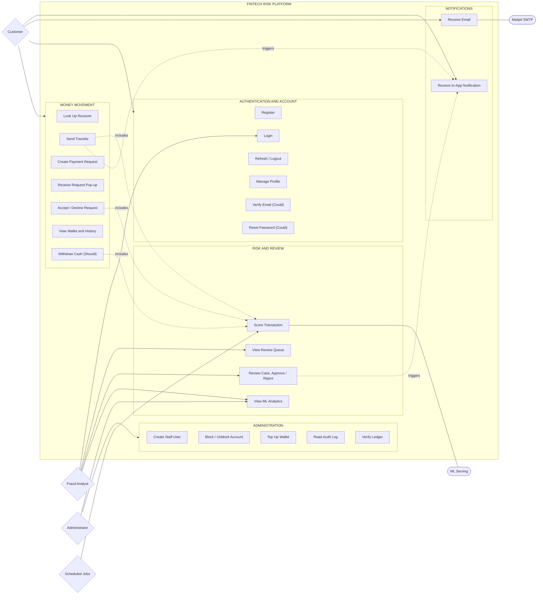

---

## 6. Core System Responsibilities

Priority: **M** = Must, **S** = Should, **C** = Could.

| # | Responsibility | Service | Description | P |
|---|---|---|---|:-:|
| 1 | User registration | Auth | Create credentials, emit `UserRegistered`, provision profile and wallet | M |
| 2 | Authentication | Auth | Login, JWT (RS256) issuance, lockout after repeated failures | M |
| 3 | Session management | Auth | Rotating refresh tokens, revocation, reuse detection | M |
| 4 | Staff provisioning | Auth | Admin creates `ANALYST` and `ADMIN` accounts | M |
| 5 | Email verification and password reset | Auth + Notification | Token-based flows via Mailpit | C |
| 6 | Service identity | Auth | Service tokens and JWKS for internal calls | M |
| 7 | Profile management | Customer | Profile read/update, simulated KYC status | M |
| 8 | Receiver lookup | Customer | Resolve email/username/phone to receiver ID and masked name, rate-limited | M |
| 9 | Account status | Customer | Block/unblock, replicate status to other services | M |
| 10 | Wallet and ledger | Transaction | Balances, holds, append-only ledger, invariants | M |
| 11 | Transfer processing | Transaction | Validate, hold, score, execute or release (`TRANSFER`; `CASH_OUT` as Should) | M |
| 12 | Payment request management | Transaction | Create, accept, decline, cancel, expire (2-minute live request) | M |
| 13 | Idempotency | Transaction | Safe retries for all money-moving requests | M |
| 14 | Stuck-transfer recovery | Transaction | Reconcile transfers interrupted by failures | M |
| 15 | Wallet administration | Transaction | Simulated top-ups, ledger verification | M |
| 16 | Risk decisioning | Risk | Call ML, apply decision policy R1–R6, store decision | M |
| 17 | Type safeguard | Risk | Unsupported transaction types are decided by rules, without an ML call | M |
| 18 | ML resilience | Risk | Timeout, retry, circuit breaker, fail-safe to review | M |
| 19 | Review case management | Risk | Queue, evidence snapshot, claim, decide, expire | M |
| 20 | Review outcome delivery | Risk | Reliable delivery of analyst decisions to Transaction | M |
| 21 | ML analytics proxy | Risk | Serve model info, statistics and visualisation JSON | M |
| 22 | Backpressure under overload | Risk + Transaction | Refuse new work when the review queue is saturated while ML is down | S |
| 23 | In-app notifications | Notification | Store, list, mark read | M |
| 24 | Email notifications | Notification | Send via Mailpit, never blocks processing | M |
| 25 | Audit trail | Audit | Append-only record of significant actions | M |
| 26 | Analyst access audit | Risk + Audit | Every case view recorded | M |
| 27 | Gateway protection | Gateway | JWT validation, routing, rate limits, `/internal/**` blocked | M |
| 28 | Event delivery | All with outbox | Transactional outbox, at-least-once delivery, deduplication | M |
| 29 | Metrics and health | All | Probes, Micrometer metrics, structured logs | M |
| 30 | Frontend dashboards | Frontend | Customer, analyst and admin interfaces | M |

---

## 7. Communication Architecture

| Type | Protocol | Direction | Purpose |
|---|---|---|---|
| HTTP REST | HTTPS (TLS terminated at Ingress) | Browser ↔ Gateway | All user-facing API calls |
| HTTP REST | HTTP (cluster-internal) | Gateway → services | Routed requests with the user's JWT |
| HTTP REST | HTTP | Transaction → Risk | Decision request for each transfer (synchronous, critical path) |
| HTTP REST | HTTP | Risk → ML Serving | `/predict` (synchronous, resilience-protected) |
| HTTP REST | HTTP | Risk → Customer, Transaction | Case evidence enrichment (best-effort) |
| HTTP REST | HTTP | Risk → Transaction | Review outcome (via outbox, retried until acknowledged) |
| Events | AMQP (Should) or HTTP fallback | Services → services | Notifications, audit, provisioning, status replication |
| SQL | TCP | Services ↔ PostgreSQL | Each service on its own schema |
| SMTP | TCP | Notification → Mailpit | Emails |
| HTTP polling | HTTP | Browser → Gateway | Notification badge, queue refresh, request status, incoming request pop-up (5 s) |
| Metrics scrape | HTTP | Prometheus → services | `/actuator/prometheus` |

**Rules**
- The user-facing critical path (`Transfer → Risk → ML`) is **synchronous**. The caller needs the answer now.
- Everything that can be eventually consistent (notifications, audit, provisioning) is **asynchronous and idempotent**.
- Services never read each other's database tables.

---

## 8. System Context Diagram

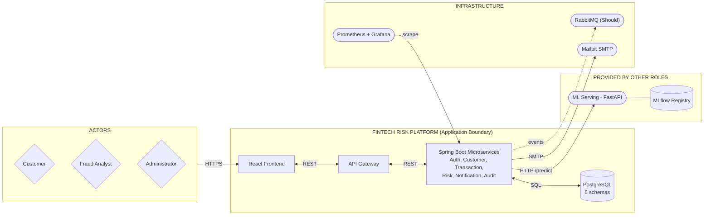

---

## 9. Container Diagram

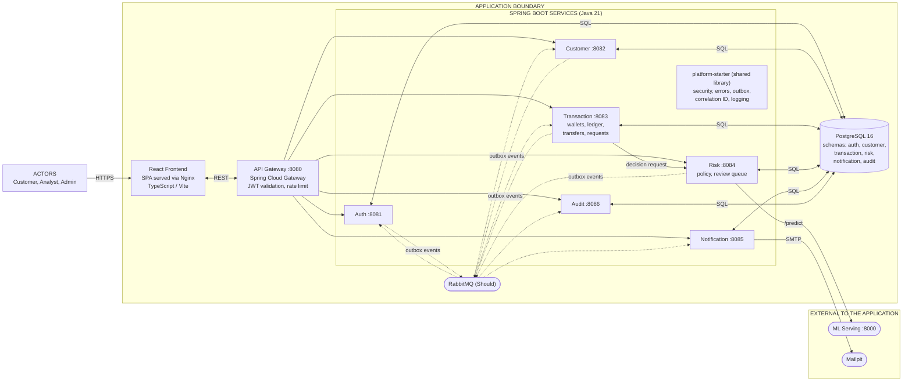

### Service port allocation

| Component | Port |
|---|---|
| API Gateway | 8080 |
| Auth | 8081 |
| Customer | 8082 |
| Transaction | 8083 |
| Risk | 8084 |
| Notification | 8085 |
| Audit | 8086 |
| ML Serving | 8000 |
| Frontend (dev) | 3000 |

### The shared platform starter

A single Spring Boot starter module consumed by all seven Spring applications. It keeps services consistent and makes the thin services cheap to build. It contains **infrastructure only, never domain code**: JWT resource-server configuration, method-security helpers, correlation-ID filter, RFC 7807 error handler, outbox library, service-token client, Micrometer common tags, JSON logging.

---

## 10. Security and Access Control

### 10.1 Authentication flows

#### Registration
1. User submits email, username, phone, password, display name.
2. Auth validates uniqueness and password policy (min 10 characters), stores the user with `role=CUSTOMER` and BCrypt hash.
3. Auth writes a `UserRegistered` event to its outbox in the same transaction.
4. Customer creates the profile. Transaction creates the wallet with the initial simulated balance (customers only). Both are idempotent by user ID.
5. Registration returns `201`. The user logs in.
6. Right after registration, profile or wallet calls may return `404 PROVISIONING` for a few seconds. The frontend retries.

#### Login
1. User submits identifier (email or username) and password.
2. Gateway applies the IP rate limit (5 login requests per minute).
3. Auth counts failed attempts for the account and IP in the last 15 minutes. If 5 or more, it returns `429 ACCOUNT_LOCKED`.
4. Auth records the attempt in `login_attempts`, verifies the BCrypt hash, and checks `enabled`.
5. Wrong credentials return one generic `401 INVALID_CREDENTIALS` (no distinction between unknown user and wrong password).
6. Blocked account: `403 ACCOUNT_RESTRICTED`.
7. On success Auth creates a refresh-token row, returns the access token in the body and sets the refresh token in an httpOnly cookie. A `LOGIN_SUCCESS` audit event is emitted.

#### Token refresh
1. Browser calls `POST /auth/refresh`. The cookie is sent automatically.
2. Auth looks up the hashed token. If not found, expired or revoked: `401`, and the frontend returns to login.
3. If a **previously rotated** token is presented again, the whole token chain is revoked (reuse detection).
4. Otherwise Auth issues a new access token and a **new refresh token** (rotation) and revokes the old one.

#### Logout
Auth revokes the refresh token and clears the cookie. The access token expires on its own within 15 minutes.

#### Staff creation
An `ADMIN` calls `POST /admin/users` with role `ANALYST` or `ADMIN`. Auth creates the user and emits `UserRegistered` with the role. Customer creates a profile. **Transaction creates no wallet for staff roles.**

#### Email verification and password reset (Could)
- Registration optionally creates a one-time verification token, emailed through Mailpit. `GET /auth/verify?token=` marks the email verified.
- `POST /auth/forgot-password` always returns `200` (prevents enumeration) and emails a one-time reset token. `POST /auth/reset-password` validates the token (unused, unexpired), updates the password hash and revokes all refresh tokens of the user.
- Tokens are stored hashed, single-use, with a short expiry.

#### Account lockout
5 failed attempts within 15 minutes from the same account and IP lock further attempts until the window passes. Counters are derived from `login_attempts` (no external cache).

### 10.2 JWT token design

| Token | TTL | Storage |
|---|---|---|
| Access token (JWT, RS256) | 15 minutes | Browser memory only |
| Refresh token (opaque, random) | 7 days, rotating | httpOnly, `SameSite=Strict` cookie scoped to `/api/v1/auth`; SHA-256 hash in `refresh_tokens` |
| Service token (JWT, role `SERVICE`) | 5 minutes | Held by the calling service, renewed before expiry |

Access token claims: `sub` (user ID), `roles`, `iss`, `aud`, `iat`, `exp`, `jti`. The private key lives only in Auth. Other services validate signatures with the public key from Auth's JWKS endpoint (cached).

### 10.3 Role-based access control

| Enforcement point | Mechanism |
|---|---|
| Gateway | Rejects requests without a valid JWT (except public routes), blocks `/internal/**`, strips client-supplied identity headers |
| Each service | Method security (`@PreAuthorize`) re-validates the JWT and role. Defence in depth: a service reached directly cannot be called without a valid token. |
| Ownership | Every query for customer data filters by the authenticated user (a user reads only their own wallet, transfers, requests, notifications) |
| Frontend | Route guards and menu filtering (UX only; never a security boundary) |

### 10.4 Rate limiting

Enforced at the Gateway with an in-memory token bucket (Bucket4j) per replica. It is approximate across replicas, and this is documented.

| Endpoint | Limit | Window | On exceed |
|---|---|---|---|
| `POST /auth/login` | 5 requests | 1 min per IP | 429 |
| `POST /auth/register` | 3 requests | 1 hour per IP | 429 |
| `POST /auth/forgot-password` (Could) | 3 requests | 1 hour per IP | 429 |
| `POST /customers/lookup` | 10 requests | 1 min per user | 429 |
| `POST /payment-requests` | 5 requests | 1 min per user | 429 |
| All other endpoints | 200 requests | 1 min per user | 429 |

Load tests must be able to relax these limits through configuration.

### 10.5 Service-to-service security
- Each service holds a `client_id` and `client_secret` (from Kubernetes Secrets) and obtains a `SERVICE` token from Auth.
- `/internal/**` requires role `SERVICE` and is never routed by the Gateway.
- NetworkPolicies (DevOps/MLOps) are an additional layer.

### 10.6 Data protection and privacy

| Concern | Rule |
|---|---|
| Passwords | BCrypt, never logged |
| Secrets | Environment variables and Kubernetes Secrets only. The repository is **public**: nothing sensitive in git, secret scanning in CI. |
| Logs | Structured JSON. No tokens, passwords, or other users' risk scores. User IDs hashed. |
| Risk data visibility | Customers never see any risk information, only the outcome. Exact probability and uncertainty are visible to analysts only. |
| Receiver lookup | Authenticated, rate-limited, audited. It returns a **masked name** and confirms existence. This is an accepted exception to non-enumeration, because a payment flow must confirm the recipient. |
| Analyst access | Role-gated, audited per case view, no export endpoint |
| Input validation | Bean Validation on all DTOs, strict JSON on money endpoints, request size limits |

---

## 11. Domain Rules and Business Logic

This section specifies correctness. Backend and Frontend must both read it.

### 11.1 Money and identifiers
- Amounts: `DECIMAL(19,2)`, `BigDecimal` in Java, **string in JSON** (`"125.50"`). Never floating point.
- One simulated currency, configured globally (`app.currency`).
- IDs: UUID. Timestamps: ISO-8601 UTC.

### 11.2 Wallet and ledger (Transaction service)

| Concept | Rule |
|---|---|
| Wallet | One per **customer or cash agent** (none for staff). Fields: `balance`, `held_amount`, `owner_status`, `owner_kind`, `owner_display_name`. `available = balance − held_amount`. |
| Initial balance | Created on `UserRegistered` with a `TOPUP` ledger entry of `app.wallet.initial-balance` (default 1,000.00). Idempotent by user ID. |
| Ledger | **Append-only.** Entry types: `TOPUP`, `HOLD`, `RELEASE`, `DEBIT`, `CREDIT`. Each entry records amount, `balance_after`, `held_after`. No updates, no deletes. |
| Invariant I1 | `balance` = Σ(TOPUP + CREDIT − DEBIT) of the wallet's ledger |
| Invariant I2 | `held_amount` = Σ(HOLD − RELEASE) of the wallet's ledger |
| Invariant I3 | Σ(all balances) = Σ(all TOPUP entries). Transfers move money, never create or destroy it. |
| Concurrency | `SELECT … FOR UPDATE` on both wallets, **locked in ascending wallet-ID order** to prevent deadlocks |
| Verification | `GET /admin/ledger/verify` recomputes I1–I3 and lists violations. It is run after every chaos experiment. |

### 11.3 Idempotency

- Every `POST` that creates or changes money state requires an `Idempotency-Key` header (UUID from the client).
- Table `idempotency_keys` with `UNIQUE(key, user_id, endpoint)` stores request hash and response.
- Same key and payload: stored response replayed (`Idempotent-Replay: true`).
- Same key, different payload: `422 IDEMPOTENCY_KEY_REUSED`.
- Same key still in progress: `409 REQUEST_IN_PROGRESS`.
- Keys are purged after 24 hours.
- The frontend creates one key per form submission and reuses it on retry. Load tests must do the same.

### 11.4 Transfer lifecycle

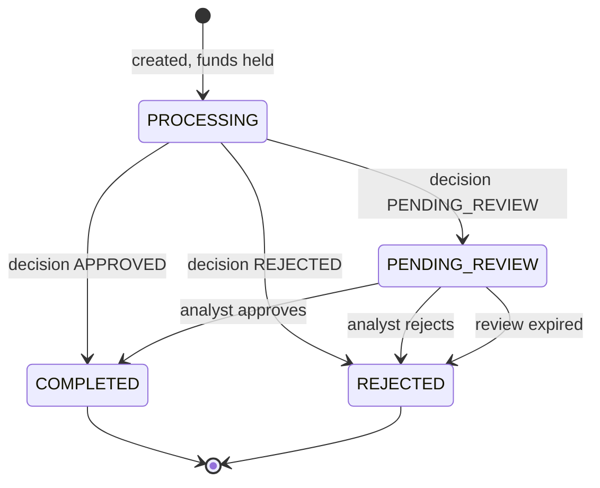

`rejection_reason` ∈ `RISK_POLICY`, `ANALYST_DECISION`, `REVIEW_EXPIRED`, `INSUFFICIENT_FUNDS`, `ACCOUNT_RESTRICTED`, `SYSTEM_ERROR`.

**Creation algorithm (Transaction service)**

1. **Tx1** (short DB transaction): validate (amount > 0 and ≤ `app.transfer.max-amount`, receiver ≠ sender, both wallets exist, both `owner_status = ACTIVE`, receiver kind matches the type (`CUSTOMER` for `TRANSFER`, `AGENT` for `CASH_OUT`), `available ≥ amount`), lock wallets, write `HOLD`, insert transfer `PROCESSING`, commit.
2. **No DB transaction is open** while calling Risk (`POST /internal/decisions`, keyed by transfer ID).
3. **Tx2:** apply the decision.
   - `APPROVED`: `RELEASE` + `DEBIT` sender + `CREDIT` receiver, status `COMPLETED`.
   - `REJECTED`: `RELEASE`, status `REJECTED` with reason.
   - `PENDING_REVIEW`: keep the hold, status `PENDING_REVIEW`.
4. Outbox events are written **in the same transaction** as the state change.
5. **Stuck-transfer reconciler** (section 18): transfers still `PROCESSING` after `app.reconciler.stuck-after` (default 2 minutes) are re-submitted to Risk. Risk's decision is idempotent per transfer ID. If Risk stays unreachable after N attempts, the transfer moves to `PENDING_REVIEW` flagged `degraded`. This guarantees that a pod killed mid-transfer never leaves funds held forever.

### 11.5 Payment request lifecycle (live request)

The **requester** (payee) asks money from the **payer**. A request is a **live request**: it is valid for a short time (`app.request.ttl`, default **2 minutes**) and the timer starts when the request is **created**, not when the payer opens it. On acceptance the payer becomes the transfer sender and the requester the transfer receiver.

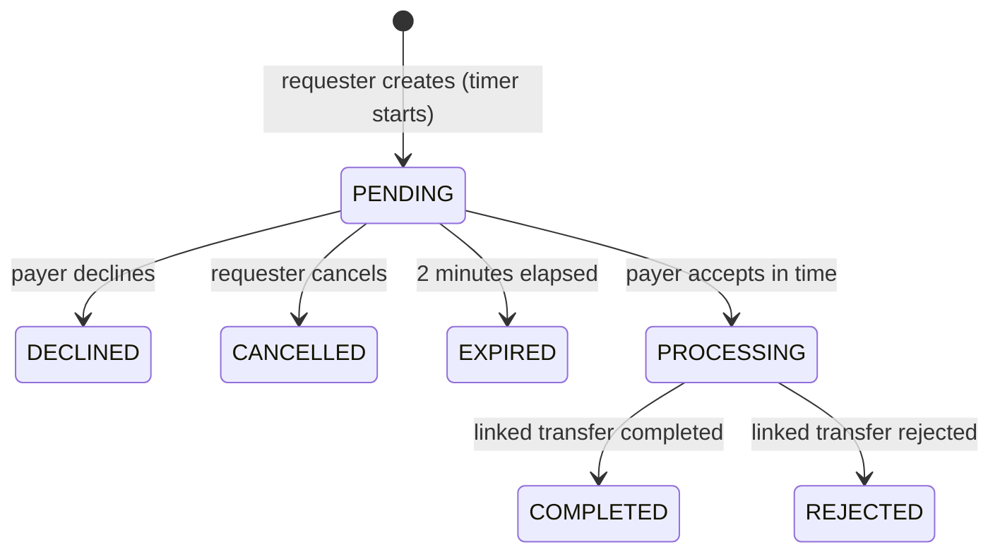

- **No scoring and no risk information** exist before the payer accepts. Nothing about risk is shown to either party at request time.
- **No lock and no reservation.** The payer's account stays fully usable. The funds check, the hold and the scoring all happen at **Accept**, with the balances at that moment, so a balance change between sending and accepting cannot make a decision stale. The short timer only limits how long an unanswered request stays actionable.
- `expiresAt = created_at + app.request.ttl`. Expiry is **enforced on the server** at read and at accept (an expired request returns `409 REQUEST_EXPIRED`). The scheduled job only marks requests `EXPIRED` and notifies the requester.
- **Payer pop-up:** the frontend polls incoming `PENDING` requests every 5 seconds and shows a pop-up with requester (masked name), amount, note and a countdown. The countdown uses the server's `expiresAt` and `serverTime`, so browser clock differences do not matter.
- If the balance is too low at Accept, the call fails with `INSUFFICIENT_FUNDS` and the request stays `PENDING` until it expires.
- **Abuse limits:** at most 5 request creations per minute per user, and only one `PENDING` request per requester and payer pair. A payer-side "block requester" action is a Could.
- Requests are **immutable** after creation (amount, payer, note). A request always results in a `TRANSFER`; cash agents can neither send nor receive requests.
- `PROCESSING` means a transfer exists and is being scored or reviewed (up to 24 hours).
- The requester sees status and a neutral message only.

### 11.6 Scoring pipeline

Every transfer, whether created directly or from an accepted payment request, is scored **exactly once**, when it is created.

1. Transaction runs Tx1 (validation, funds check, hold) and calls Risk with `POST /internal/decisions`, keyed by the transfer ID.
2. Risk applies the decision policy (section 11.7). It calls ML Serving only when the accounts are active and the transaction type is supported by the application (rule R1b).
3. Risk stores the decision. If the result is `PENDING_REVIEW`, it opens a review case.
4. Risk is **idempotent per transfer ID**: a repeated call (for example from the stuck-transfer reconciler) returns the stored decision without calling ML again.
5. Transaction applies the decision as described in section 11.4.

There is no preview, no fingerprint and no freshness logic: because the only score is computed at execution time, it always describes the current situation.

### 11.7 Decision policy and transaction types

#### Transaction types

ML Training trains on **all five PaySim types**. PaySim contains fraud **only** in `TRANSFER` and `CASH_OUT`; `PAYMENT`, `DEBIT` and `CASH_IN` are never fraudulent in the data. The application creates only `TRANSFER` and `CASH_OUT`, so those are the current types that reach the model in production.

| Type | In the application |  |
|---|---|---|
| `TRANSFER` | Yes (core: Transfer and accepted Payment Request) | 
| `CASH_OUT` | **Should**: a "withdraw cash" operation to a seeded cash-agent account 
| `CASH_IN` | Not offered. It corresponds to the admin top-up. | 
| `PAYMENT`, `DEBIT` | Not offered (no merchants in the application) | 

#### Cash agents (Should)

- A cash agent is a seeded account with `accountKind = AGENT` (created through `POST /admin/users` or the seed tool). It has a normal wallet, so ledger invariants I1–I3 are unchanged.
- `CASH_OUT` goes through `POST /transfers` with `type = CASH_OUT`. The receiver must be an agent. A `TRANSFER` receiver must be a regular customer. A mismatch returns `422 INVALID_RECEIVER_KIND`.
- Agents start with a balance of 0 and cannot log in as customers of the money-movement screens (they have no customer UI). The admin can top them up or leave them accumulating.
- Customers pick an agent from `GET /customers/agents`. Receiver lookup never returns agents.
- Both types use the same scoring, review and notification flow. The seed tool and simulator replay the "transfer, then cash out" pattern for demos and load tests.

#### Policy rules

Rules are evaluated **in order**; the first match wins. `policy_version` is stored with every decision.

| Order | Condition | Decision | Reason code |
|---|---|---|---|
| R1 | Sender or receiver not `ACTIVE` | `REJECTED` | `ACCOUNT_RESTRICTED` |
| R1b | Type not supported by the application (defensive, no ML call) and amount ≥ `risk.policy.high-amount-threshold` | `PENDING_REVIEW` | `AMOUNT_HIGH` |
| R1b | Type not supported by the application (defensive, no ML call) | `APPROVED` | `TYPE_NOT_SCORED` |
| R2 | ML unavailable, timeout, circuit open, or invalid response | `PENDING_REVIEW`, `degraded=true` | `SERVICE_DEGRADED` |
| R3 | Prediction set = {fraud} | `REJECTED` | `MODEL_HIGH_RISK` |
| R4 | Prediction set = {legit, fraud} or empty | `PENDING_REVIEW` | `MODEL_UNCERTAIN` |
| R5 | Prediction set = {legit} and amount ≥ `risk.policy.high-amount-threshold` | `PENDING_REVIEW` | `AMOUNT_HIGH` |
| R6 | Prediction set = {legit} | `APPROVED` | none |

R1b is a **defensive rule**: the application only creates `TRANSFER` and `CASH_OUT`, so it normally never fires.

ML Serving may return an `action` field. It is treated as a **suggestion only**. The Risk service owns the final decision.

**Overload behaviour (Should).** While ML is degraded, review cases are prioritised (large amounts first). If open cases exceed `risk.review.max-open`, new transfers are refused with `503 TEMPORARILY_UNAVAILABLE` and `Retry-After`, **before** funds are held.

#### Messages shown to the customer

Customers never see a probability, a band or an indicator. They only see the outcome.

| Outcome | Message |
|---|---|
| `APPROVED` | "Transfer completed." |
| `PENDING_REVIEW` | "Your transfer is under security review. You'll be notified, usually within 24 hours. Funds are reserved." |
| `REJECTED` | "This transfer was declined for security reasons." (no score, no detail) |

The interface says **"transaction risk"**, never "scam probability": the model scores the resulting transaction, not the intent of a request.

### 11.8 Review case lifecycle (Risk service)

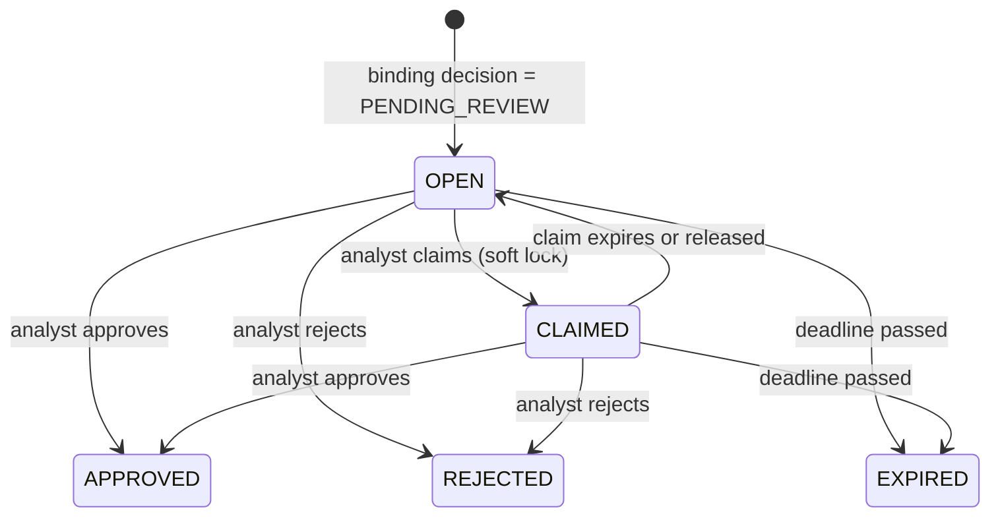

- `deadline = created_at + risk.review.expiry` (default 24 hours). On expiry the transfer is auto-rejected and the hold released.
- **Evidence snapshot:** at creation Risk stores a JSON snapshot: transfer details, both parties' profiles and recent activity, the stored model output (probability, uncertainty, prediction set, model version, optional explanations). Enrichment is best-effort; if it fails the case is created with `snapshot_partial=true` and re-enriched on first view.
- **Decision:** mandatory reason (≥ 10 characters), **immutable**.
- **Four-eyes (defensive):** the analyst's user ID must differ from sender and receiver. Always true because staff have no wallets, still checked.
- **Delivery to Transaction:** Risk persists the decision and an outbox row in one transaction. The outbox poller calls `POST /internal/transfers/{id}/review-outcome` (idempotent) until acknowledged.
- Every case view writes a `case_access_log` row and an audit event.

### 11.9 Replicated state and eventual consistency

| Data | Owner | Replicated to | Mechanism |
|---|---|---|---|
| User ID, email, username, phone, role, account kind | Auth | Customer (full), Transaction (ID, role and account kind only) | `UserRegistered` event |
| Display name | Customer | Transaction (`owner_display_name`) | `UserRegistered`, `CustomerProfileUpdated` events |
| Account status | Customer | Transaction (`owner_status`), Auth (`enabled`) | `AccountStatusChanged` event |

---

## 12. Sequence Diagrams

### 12.1 Registration and provisioning

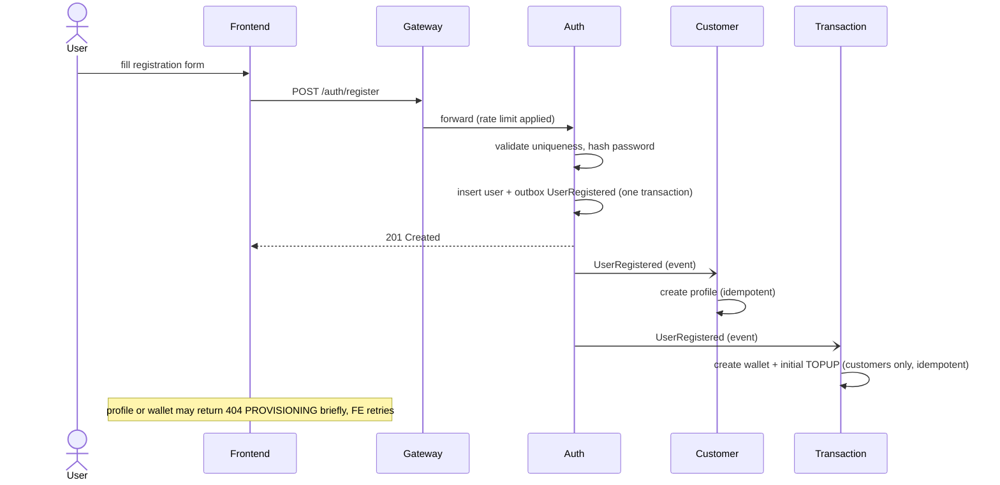

### 12.2 Login

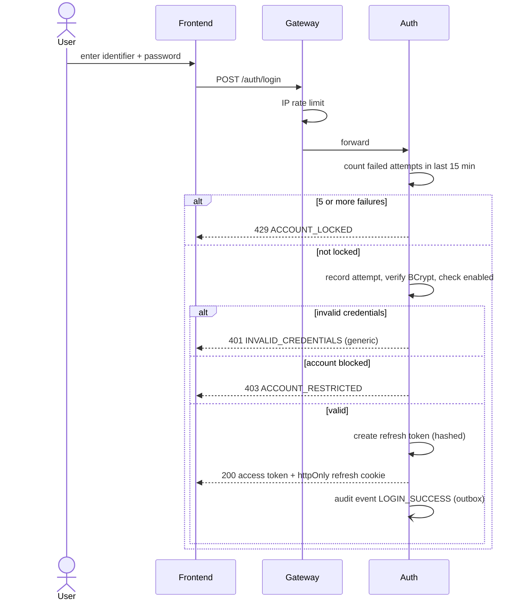

### 12.3 Token refresh and logout

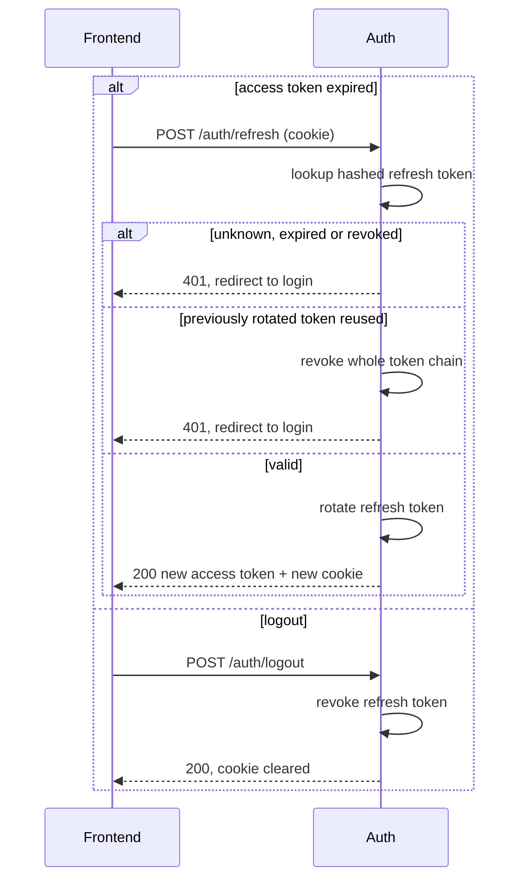

### 12.4 Administrator creates a staff user

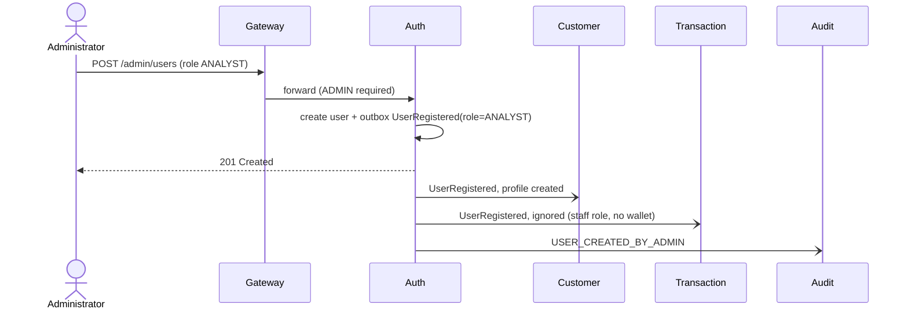

### 12.5 Receiver lookup

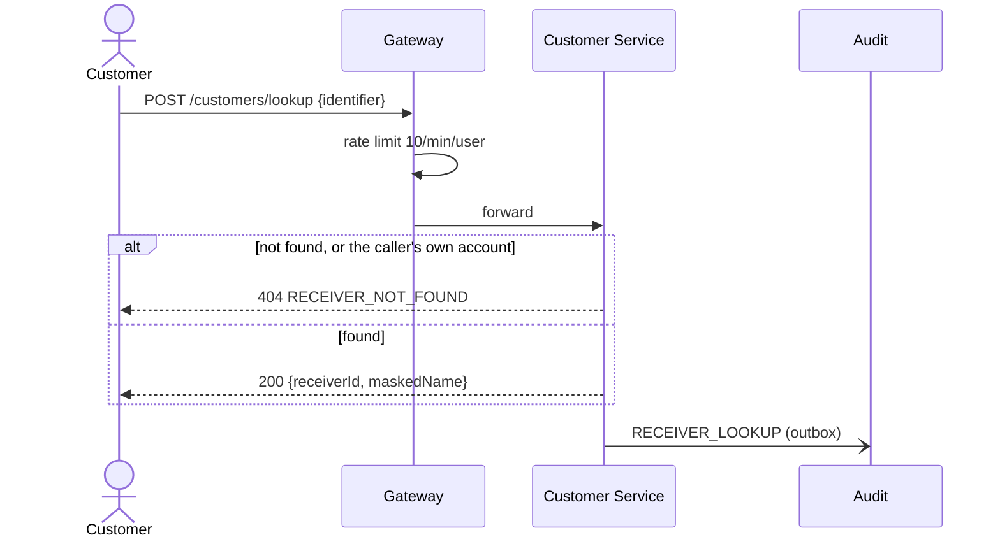

### 12.6 Direct transfer

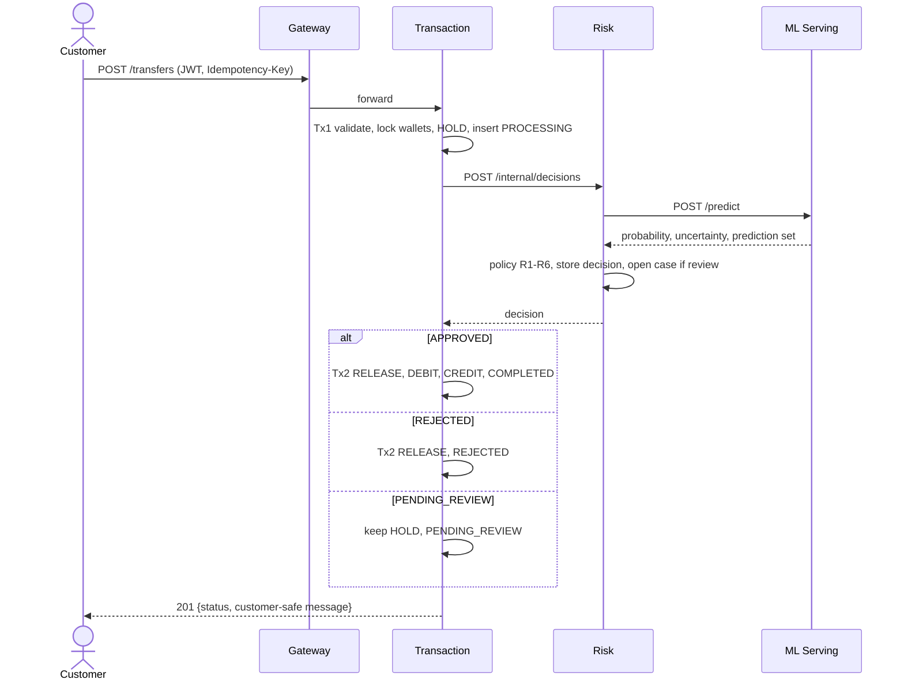

### 12.7 Payment request: create and accept (live request)

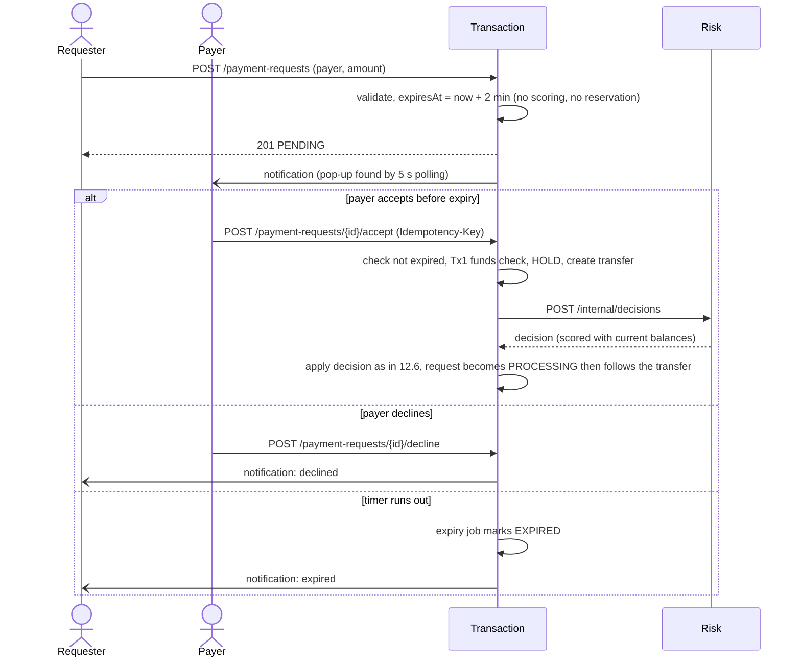

### 12.8 Analyst review

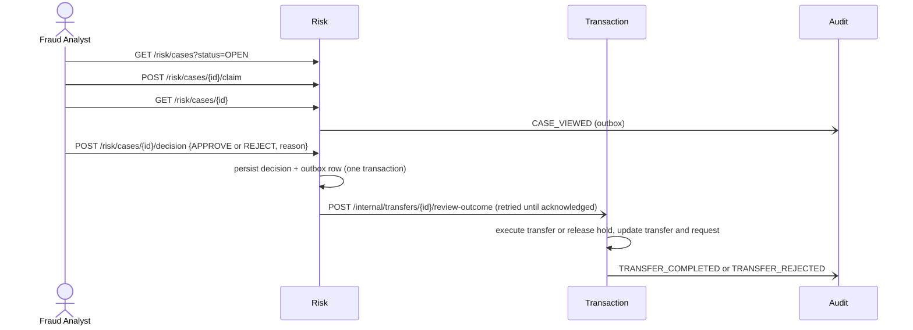

### 12.9 Review expiry and stuck-transfer reconciliation

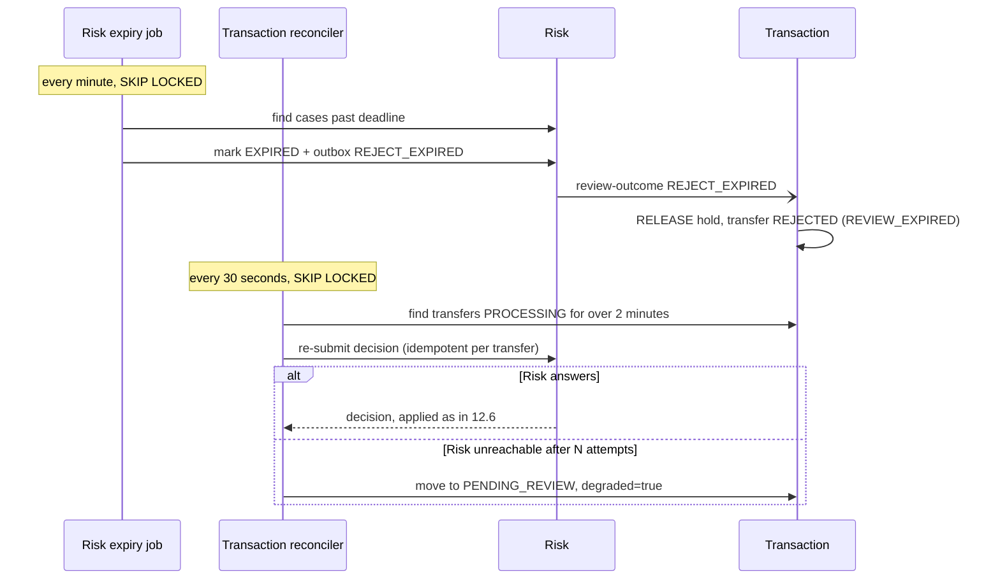

### 12.10 ML failure and fail-safe

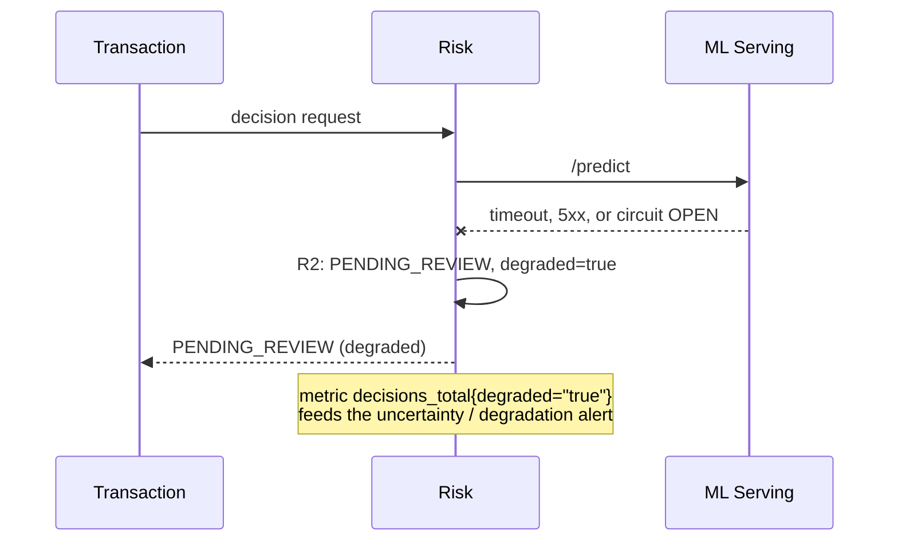

### 12.11 Notification delivery

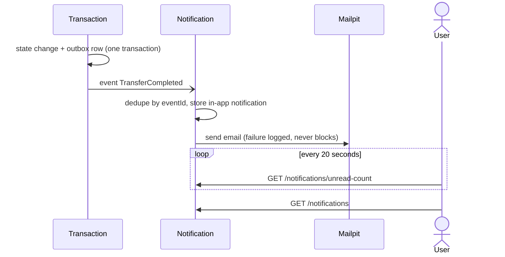

### 12.12 Event delivery when the broker is down, then recovered

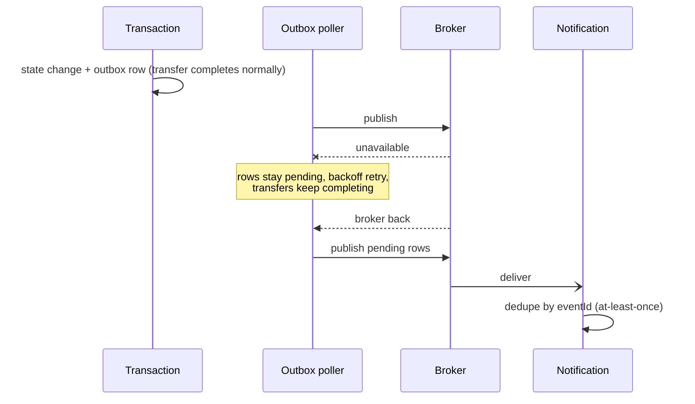

---

## 13. Database Architecture

### 13.1 Overview

One PostgreSQL instance with **six schemas**, one per service, each accessed by its own DB user. Each service migrates its own schema with Flyway (forward-only, backward-compatible across one release so rolling updates and rollbacks are safe).

Common to services that send or receive events:
- `outbox(id, event_id, type, payload, created_at, delivered_at, attempts)`: events to send.
- `processed_events(event_id PK, processed_at)`: deduplication of received events (Notification and Audit use a unique `event_id` column instead).

PaySim fields appear only inside `decisions.features_json` and the ML contract. Application tables store domain data, not model features.

### 13.2 Table groups

#### Group 1: Auth (schema `auth`)
- **users**: identity and credentials (email, username, phone, password hash, role, enabled).
- **refresh_tokens**: hashed rotating refresh tokens with revocation and replacement chain.
- **login_attempts**: durable record of every login attempt, source for lockout.
- **service_clients**: machine credentials for `SERVICE` tokens.
- **email_verification_tokens**, **password_reset_tokens** (Could): hashed single-use tokens.

#### Group 2: Customer (schema `customer`)
- **customers**: profile, simulated KYC status, account status, copies of identifiers used for lookup.

#### Group 3: Transaction (schema `transaction`)
- **wallets**: balance, held amount, replicated owner status and display name.
- **ledger_entries**: append-only record of every balance or hold movement.
- **transfers**: lifecycle of every money movement.
- **payment_requests**: request lifecycle and link to the resulting transfer.
- **idempotency_keys**: stored responses for safe retries.

#### Group 4: Risk (schema `risk`)
- **decisions**: every scoring result, with the ML output and the applied policy version.
- **review_cases**: queue items with evidence snapshot, claim, deadline and resolution.
- **case_access_log**: who viewed which case and when.

#### Group 5: Notification and Audit (schemas `notification`, `audit`)
- **notifications**: in-app notifications per user.
- **email_log**: delivery attempts.
- **audit_events**: immutable audit trail. The service's DB user has `INSERT` and `SELECT` only.

### 13.3 Entity-relationship diagram

Relations are drawn **within** each schema. There are no foreign keys across schemas; section 14 explains how they link.

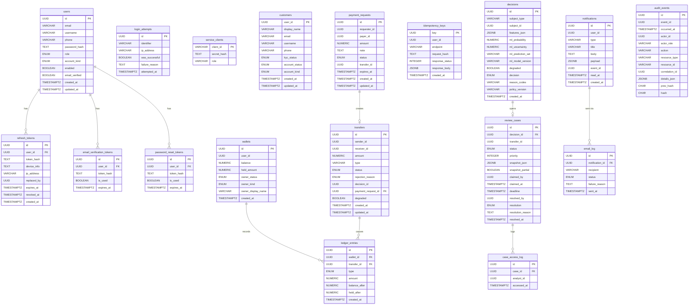

### 13.4 Key constraints and indexes

| Table | Constraint / index | Purpose |
|---|---|---|
| `users` | Unique `email`, `username`, `phone` | Identity |
| `refresh_tokens` | Index on `token_hash`, on `user_id` | Fast lookup and bulk revoke |
| `login_attempts` | Index on `(identifier, attempted_at)`, `(ip_address, attempted_at)` | Lockout counting |
| `wallets` | Unique `user_id` | One wallet per customer |
| `ledger_entries` | Index on `(wallet_id, created_at)` | Ledger pages and invariant checks |
| `transfers` | Index on `(status, updated_at)`, `sender_id`, `receiver_id` | Reconciler and history |
| `idempotency_keys` | Unique `(key, user_id, endpoint)` | Replay detection |
| `decisions` | Unique `subject_id` | One decision per transfer |
| `payment_requests` | Unique `(requester_id, payer_id)` where `status = 'PENDING'`; index on `(payer_id, status)` | One open request per pair, fast pop-up query |
| `review_cases` | Index on `(status, priority, deadline)` | Queue ordering and expiry |
| `audit_events` | Unique `event_id`, index on `(actor_id, occurred_at)`, `(resource_type, resource_id)` | Deduplication and search |
| `outbox` | Partial index where `delivered_at IS NULL` | Fast poller |

---

## 14. Cross-Service Data Bridge

### 14.1 Bridge pattern

Services are connected **by convention, not by database constraints**. Identifiers are copied between services; there are no cross-schema foreign keys.

| Reference | Stored in | Type | Points to |
|---|---|---|---|
| User | `customers.user_id`, `wallets.user_id`, `transfers.sender_id/receiver_id`, `payment_requests.requester_id/payer_id`, `notifications.user_id`, `audit_events.actor_id` | UUID | `auth.users.id` |
| Transfer | `decisions.subject_id`, `review_cases.transfer_id`, `ledger_entries.transfer_id` | UUID | `transaction.transfers.id` |
| Decision | `transfers.decision_id` | UUID | `risk.decisions.id` |
| Audit resource | `audit_events.resource_type + resource_id` | VARCHAR | Any entity |

Consequence: referential integrity across services is enforced by the application logic and by idempotent event handling, not by the database.

### 14.2 Cross-service data fetch patterns

| Need | Pattern |
|---|---|
| Transfer list with counterparty names | Transaction reads `wallets.owner_display_name` (same schema, no call). Names of counterparties are masked in responses. |
| Analyst case detail | Evidence is **snapshotted** when the case opens (Risk calls Customer and Transaction once, best-effort). Viewing a case reads the snapshot, with no live joins. |
| Receiver validation at transfer time | Transaction checks its **local replica** of `owner_status`. No call to Customer. |

### 14.3 Denormalisation strategy

Fields are copied at write time to avoid cross-service calls on reads and to keep services independent during failures.

| Denormalised field | Table | Source | When set |
|---|---|---|---|
| `email`, `username`, `phone` | `customers` | `auth.users` | `UserRegistered` |
| `owner_display_name` | `wallets` | `customers.display_name` | `UserRegistered`, `CustomerProfileUpdated` |
| `owner_status` | `wallets` | `customers.account_status` | `UserRegistered`, `AccountStatusChanged` |
| `owner_kind` | `wallets` | `auth.users.account_kind` | `UserRegistered` |
| `enabled` | `users` | `customers.account_status` | `AccountStatusChanged` |
| `features_json` | `decisions` | Transaction's request | At scoring time |
| `snapshot_json` | `review_cases` | Customer, Transaction, ML output | At case creation |

### 14.4 Consistency rules

- Replicated fields may be briefly stale (typically seconds). The only safety-critical replica is `owner_status`, which Risk re-checks in rule R1 using the values supplied at decision time.
- A blocked account is therefore enforced at three levels: login disabled (Auth), transfers refused (Transaction local check), decision rule R1 (Risk).
- Snapshot fields are **historical evidence** and are never updated afterwards.
- Events are delivered **at least once** and may arrive out of order. Handlers must be idempotent and tolerate reordering.

---

## 15. Messaging Architecture

The application exchanges asynchronous events using a **transactional outbox**. A message broker (RabbitMQ) is a **Should**: it improves fan-out and buffering, but the system works without it.

### 15.1 Principles

- The synchronous critical path (`Transaction → Risk → ML`) never uses the broker.
- A service writes its state change and its event in **one database transaction** (the outbox row). A poller then delivers the event. This avoids losing events when a pod dies between the commit and the send.
- Delivery is **at least once**. Consumers deduplicate by `eventId`.
- Pollers are multi-replica safe (`FOR UPDATE SKIP LOCKED`).
- The delivery mechanism sits behind a `Publisher` interface with two implementations: **RabbitMQ** (default) and **HTTP** (fallback posting to `/internal/events`). Switching is a configuration change.

### 15.2 Event catalog

| Event | Producer | Consumers |
|---|---|---|
| `UserRegistered` | Auth | Customer, Transaction, Audit |
| `CustomerProfileUpdated` | Customer | Transaction |
| `AccountStatusChanged` | Customer | Transaction, Auth, Audit, Notification |
| `PaymentRequestCreated`, `…Accepted`, `…Declined`, `…Cancelled`, `…Expired` | Transaction | Notification, Audit |
| `TransferCompleted`, `TransferRejected`, `TransferSentToReview` | Transaction | Notification, Audit |
| `DecisionMade` | Risk | Audit |
| `NewCaseOpened`, `ReviewDecisionMade`, `CaseExpired` | Risk | Notification, Audit |
| `CaseViewed` | Risk | Audit |
| `LoginSucceeded`, `LoginFailed`, `UserCreatedByAdmin` | Auth | Audit |
| `ReceiverLookedUp` | Customer | Audit |
| `WalletToppedUp` | Transaction | Audit, Notification |

The review outcome from Risk to Transaction is a **command with acknowledgement** and always uses HTTP (`/internal/transfers/{id}/review-outcome`), retried by the outbox until acknowledged.

### 15.3 Event envelope

```json
{
  "eventId": "uuid",
  "type": "TransferCompleted",
  "occurredAt": "2026-11-20T10:15:00Z",
  "correlationId": "uuid",
  "actor": { "id": "uuid", "role": "CUSTOMER" },
  "resource": { "type": "TRANSFER", "id": "uuid" },
  "data": { }
}
```

### 15.4 Topology (when RabbitMQ is used)

| Element | Design |
|---|---|
| Exchange | One durable topic exchange `fintech.events` |
| Routing key | `<service>.<resource>.<event>` (for example `transaction.transfer.completed`) |
| Queues | One durable queue per consumer service, bound to the events it needs |
| Failures | Manual acknowledgement, bounded retries, then a dead-letter queue per consumer |

**Honest limit.** On a single-node minikube cluster the broker is a single point of failure for asynchronous flows. Messages are durable and recover after a restart, but this is not a clustered broker. The report should state this plainly.

---

## 16. API Endpoint Reference

Base path: `/api/v1`. Internal paths (`/internal/**`) are never routed by the Gateway. Idempotency column: **Y** = `Idempotency-Key` header required.

### 16.1 Auth service

| Method | Endpoint | Auth | Idem. | Description |
|---|---|---|:-:|---|
| POST | `/auth/register` | none | | Create a `CUSTOMER` account |
| POST | `/auth/login` | none | | Login, returns access token, sets refresh cookie |
| POST | `/auth/refresh` | refresh cookie | | Rotate refresh token, new access token |
| POST | `/auth/logout` | JWT | | Revoke refresh token |
| GET | `/auth/verify` | none | | Verify email by token (Could) |
| POST | `/auth/forgot-password` | none | | Request reset email, always 200 (Could) |
| POST | `/auth/reset-password` | none | | Reset password by token (Could) |
| POST | `/admin/users` | ADMIN | | Create `ANALYST`, `ADMIN`, or a cash agent (Should) |
| GET | `/.well-known/jwks.json` | internal | | Public keys for RS256 validation |
| POST | `/internal/auth/service-token` | client credentials | | Issue `SERVICE` token |

### 16.2 Customer service

| Method | Endpoint | Auth | Idem. | Description |
|---|---|---|:-:|---|
| GET | `/customers/me` | JWT | | Own profile |
| PUT | `/customers/me` | JWT | | Update display name |
| POST | `/customers/lookup` | CUSTOMER | | `{identifier}` → `{receiverId, maskedName}` or `404 RECEIVER_NOT_FOUND` (never returns agents) |
| GET | `/customers/agents` | CUSTOMER | | List cash agents for withdrawals (Should) |
| GET | `/customers` | ADMIN | | Search and list customers |
| PATCH | `/customers/{id}/status` | ADMIN | | `ACTIVE` or `BLOCKED` |
| GET | `/internal/customers/{id}` | SERVICE | | Full profile (case snapshots) |

### 16.3 Transaction service

| Method | Endpoint | Auth | Idem. | Description |
|---|---|---|:-:|---|
| GET | `/wallet` | CUSTOMER | | Balance, held, available |
| GET | `/wallet/ledger` | CUSTOMER | | Paginated ledger entries |
| POST | `/transfers` | CUSTOMER | Y | Create a transfer (`type`: `TRANSFER`, or `CASH_OUT` as Should) |
| GET | `/transfers` | CUSTOMER | | Own transfers (sender or receiver), filters |
| GET | `/transfers/{id}` | CUSTOMER | | Transfer detail (receiver sees no risk data) |
| POST | `/payment-requests` | CUSTOMER | Y | Requester creates a live request (expires after `app.request.ttl`, default 2 minutes) |
| GET | `/payment-requests` | CUSTOMER | | `?role=incoming\|outgoing&status=` |
| GET | `/payment-requests/{id}` | CUSTOMER | | Detail (payer or requester only) |
| POST | `/payment-requests/{id}/accept` | payer | Y | Accept before expiry: funds check, hold, create and score the transfer |
| POST | `/payment-requests/{id}/decline` | payer | | Decline |
| POST | `/payment-requests/{id}/cancel` | requester | | Cancel |
| POST | `/admin/wallets/{userId}/topup` | ADMIN | Y | Simulated top-up |
| GET | `/admin/ledger/verify` | ADMIN | | Invariants I1–I3 |
| POST | `/internal/transfers/{id}/review-outcome` | SERVICE | | `{outcome: APPROVE\|REJECT\|REJECT_EXPIRED, caseId}`, idempotent |
| GET | `/internal/users/{id}/activity-summary` | SERVICE | | Recent activity for case snapshots |
| POST | `/internal/events` | SERVICE | | Event intake (HTTP fallback delivery) |

The payer's pop-up polls `GET /payment-requests?role=incoming&status=PENDING` every 5 seconds. Responses include `expiresAt` and `serverTime`, and an expired request is never returned as `PENDING`.

### 16.4 Risk service

| Method | Endpoint | Auth | Idem. | Description |
|---|---|---|:-:|---|
| POST | `/internal/decisions` | SERVICE | | Decision request, idempotent per transfer ID (a repeated call returns the stored decision) |
| GET | `/risk/cases` | ANALYST, ADMIN | | Queue, filters: status, priority, deadline, amount |
| GET | `/risk/cases/{id}` | ANALYST, ADMIN | | Full evidence. **Audited.** |
| POST | `/risk/cases/{id}/claim` | ANALYST | | Soft lock (Should) |
| POST | `/risk/cases/{id}/release` | ANALYST | | Release claim |
| POST | `/risk/cases/{id}/decision` | ANALYST | | `{decision: APPROVE\|REJECT, reason}`, immutable |
| GET | `/risk/cases/history` | ANALYST | | Own decisions |
| GET | `/risk/stats` | ANALYST, ADMIN | | Decision counts, review rate, degraded ratio |
| GET | `/risk/model-info` | ANALYST, ADMIN | | Proxy of ML `/model-info` |
| GET | `/risk/viz/{method}` | ANALYST, ADMIN | | Proxy and cache of precomputed `pca`, `tsne` or `umap` JSON |

### 16.5 Notification service

| Method | Endpoint | Auth | Idem. | Description |
|---|---|---|:-:|---|
| GET | `/notifications` | JWT | | Paginated, `?unread=` |
| GET | `/notifications/unread-count` | JWT | | Bell badge |
| PATCH | `/notifications/{id}/read` | JWT | | Mark one read |
| POST | `/notifications/read-all` | JWT | | Mark all read |
| POST | `/internal/events` | SERVICE | | Event intake, deduplicated by `eventId` |

### 16.6 Audit service

| Method | Endpoint | Auth | Idem. | Description |
|---|---|---|:-:|---|
| GET | `/audit` | ADMIN | | Filters: actor, action, resource, date range |
| POST | `/internal/events` | SERVICE | | Append only |

**Audited actions (minimum):** `USER_REGISTERED`, `LOGIN_SUCCESS`, `LOGIN_FAILED`, `USER_CREATED_BY_ADMIN`, `ACCOUNT_STATUS_CHANGED`, `RECEIVER_LOOKUP`, `TRANSFER_CREATED`, `TRANSFER_COMPLETED`, `TRANSFER_REJECTED`, `DECISION_MADE`, `CASE_OPENED`, `CASE_VIEWED`, `CASE_DECIDED`, `CASE_EXPIRED`, `WALLET_TOPUP`. An optional hash chain (`hash = SHA256(prev_hash + record)`) adds tamper evidence (Could). Audit is **never on the critical path**: if it is down, business operations continue and events wait in the producers' outboxes.

### 16.7 Gateway routing

| Public prefix | Target |
|---|---|
| `/auth/**`, `/admin/users/**` | Auth |
| `/customers/**` | Customer |
| `/wallet/**`, `/transfers/**`, `/payment-requests/**`, `/admin/wallets/**`, `/admin/ledger/**` | Transaction |
| `/risk/**` | Risk |
| `/notifications/**` | Notification |
| `/audit/**` | Audit |
| `/internal/**` | **Blocked** |

Gateway timeouts: connect 1 s, response 5 s. It injects `X-Correlation-Id` and strips client-supplied identity headers.

### 16.8 Pagination and headers

- Pagination: `?page=0&size=20&sort=createdAt,desc` returns `{ "items": [], "page": 0, "size": 20, "totalItems": 134 }`.
- Headers: `Authorization: Bearer`, `Idempotency-Key`, `X-Correlation-Id` (returned on every response).
- **OpenAPI-first:** each service's spec is committed under `docs/api/` and the frontend client is generated from it.

---

## 17. Spring ↔ ML Serving Integration Contract

Risk is the **only** Spring service that talks to ML Serving.

### 17.1 Request: `POST {ml}/predict`

```json
{
  "schema_version": "1.0",
  "request_id": "uuid",
  "features": {
    "type": "TRANSFER",
    "amount": 1250.50,
    "sender_old_balance": 5000.00,
    "sender_new_balance": 3749.50,
    "receiver_old_balance": 100.00,
    "receiver_new_balance": 1350.50
  }
}
```

Feature names above are the **PaySim v0**. The `type` field uses the five PaySim values (`TRANSFER`, `CASH_OUT`, `PAYMENT`, `CASH_IN`, `DEBIT`) because the model is trained on all of them. Whether ML Serving will accept all five is still to be confirmed. The application sends only `TRANSFER` and `CASH_OUT`; other types never reach `/predict` (rule R1b). The final list is fixed with ML Training (section 24). `*_new_balance` values are **computed by the application** as the expected post-transfer balances, because the decision is made before execution.

### 17.2 Response

```json
{
  "schema_version": "1.0",
  "action": "HUMAN_REVIEW",
  "fraud_probability": 0.0132,
  "uncertainty": {
    "method": "split_conformal",
    "confidence_level": 0.95,
    "prediction_set": ["legit"],
    "score": 0.08
  },
  "model": { "name": "fraud-xgb", "version": "7", "stage": "Production" },
  "explanations": [ { "feature": "amount", "contribution": 0.31 } ],
  "inference_ms": 7.4
}
```

- `prediction_set` ⊆ {`legit`, `fraud`}; it may be empty or contain both.
- `uncertainty.score` ∈ [0, 1] is a scalar for dashboards and alerts. Its definition is owned by ML Serving.
- `action` (`ALLOW`, `BLOCK`, `HUMAN_REVIEW`) is a **suggestion**. The Risk policy (section 11.7) decides.
- `explanations` is optional and shown to analysts only.

### 17.3 Resilience configuration (Risk → ML)

| Setting | Default |
|---|---|
| Connect timeout | 500 ms |
| Read timeout | 1500 ms |
| Retry | 1 retry on connect error or 5xx (prediction has no side effects) |
| Circuit breaker | Window of 20 calls, opens at 50% failures or 50% slow calls (> 1 s), half-open after 10 s with 3 trial calls |
| Bulkhead | Max 25 concurrent ML calls per Risk replica |
| Fallback | Rule R2: `PENDING_REVIEW`, `degraded=true` |
| Response validation | Unknown major `schema_version`, missing fields, probability outside [0, 1] → treated as failure (R2) |

### 17.4 Latency budget for `POST /transfers`

| Hop | Budget |
|---|---|
| Gateway response timeout | 5 s |
| Transaction → Risk | 3 s |
| Risk → ML (including the retry) | 1.5 s |
| ML inference target (p95) | < 300 ms |

### 17.5 Auxiliary ML endpoints

| Endpoint | Purpose |
|---|---|
| `GET /health/live`, `GET /health/ready` | Probes (ready only after the model is loaded) |
| `GET /model-info` | Model name, version, stage, metrics summary, conformal level |
| `GET /viz/{pca\|tsne\|umap}` | Static JSON with precomputed embeddings |
| `GET /metrics` | Prometheus metrics |

---

## 18. Scheduled Jobs and Asynchronous Processing

### 18.1 Overview

Every Spring service may run several replicas under autoscaling, so **every job is multi-replica safe**: work rows are claimed with `SELECT … FOR UPDATE SKIP LOCKED`, and jobs are idempotent. Intervals and batch sizes are configurable properties.

### 18.2 Job catalog

| Job | Service | Interval | Batch | Purpose |
|---|---|---|---|---|
| Outbox poller | All with outbox | 1 s | 100 | Deliver pending events, exponential backoff on failure |
| Stuck-transfer reconciler | Transaction | 30 s | 50 | Re-submit transfers `PROCESSING` for more than 2 minutes |
| Payment-request expiry | Transaction | 30 s | 200 | Mark `PENDING` requests past `expiresAt` as `EXPIRED` and notify the requester (expiry is also enforced on read and accept) |
| Idempotency-key purge | Transaction | 1 hour | 1000 | Delete keys older than 24 hours |
| Review-case expiry | Risk | 1 min | 100 | Expire cases past their deadline, queue `REJECT_EXPIRED` |
| Claim expiry | Risk | 1 min | 100 | Reopen cases whose claim is older than 15 minutes (Should) |
| Email retry | Notification | 30 s | 50 | Retry failed emails a bounded number of times |
| Refresh-token purge | Auth | daily | 1000 | Delete expired and revoked tokens |

### 18.3 Failure behaviour

| Failure | Behaviour |
|---|---|
| Pod killed mid-transfer | Held funds are recovered by the reconciler. Ledger invariants are re-checked afterwards. |
| Risk unreachable | Transfer is retried by the reconciler, then falls back to `PENDING_REVIEW` (degraded) |
| ML unreachable | Rule R2, fail-safe to human review |
| Audit or Notification down | Business operations continue, events accumulate in the producers' outboxes and drain on recovery |
| Review outcome not acknowledged | Risk's outbox retries until Transaction acknowledges (handler is idempotent) |
| Broker down (if used) | Outbox rows stay pending, delivery resumes on recovery |

---

## 19. Error Handling Conventions

### 19.1 Standard error response

Errors follow RFC 7807 (`application/problem+json`):

```json
{
  "type": "https://fintech.local/errors/insufficient-funds",
  "title": "Insufficient funds",
  "status": 422,
  "code": "INSUFFICIENT_FUNDS",
  "detail": "Available balance is lower than the requested amount.",
  "correlationId": "uuid",
  "errors": [ { "field": "amount", "message": "must be ≤ available balance" } ]
}
```

### 19.2 Standard success responses

Single resources return the resource directly. Lists use the pagination envelope in section 16.8. Money is always a string.

### 19.3 HTTP status code reference

| Code | Meaning | When used |
|---|---|---|
| 200 | OK | Successful GET, PATCH, or replay of an idempotent request |
| 201 | Created | Resource created (including a transfer, whatever its business outcome) |
| 204 | No Content | Successful delete |
| 400 | Bad Request | Validation failure |
| 401 | Unauthorized | Missing, expired or invalid token |
| 403 | Forbidden | Valid token, insufficient role or restricted account |
| 404 | Not Found | Resource missing or not owned by the caller |
| 409 | Conflict | Invalid state transition, request in progress, case already claimed |
| 422 | Unprocessable | Business rule violation |
| 429 | Too Many Requests | Rate limit or lockout |
| 503 | Service Unavailable | Overload protection, downstream dependency unavailable |

### 19.4 Error code catalog

| Error code | Status | Meaning |
|---|---|---|
| `VALIDATION_FAILED` | 400 | Request body invalid |
| `INVALID_CREDENTIALS` | 401 | Wrong identifier or password (generic) |
| `UNAUTHENTICATED` | 401 | Missing or invalid token |
| `TOKEN_EXPIRED` | 401 | Access or refresh token expired |
| `FORBIDDEN` | 403 | Insufficient role |
| `ACCOUNT_RESTRICTED` | 403 / 422 | Account blocked (login: 403, transfer: 422) |
| `NOT_FOUND` | 404 | Resource missing or not owned |
| `RECEIVER_NOT_FOUND` | 404 | Lookup found no receiver |
| `PROVISIONING` | 404 | Profile or wallet not yet created after registration |
| `REQUEST_IN_PROGRESS` | 409 | Same idempotency key still processing |
| `INVALID_STATE_TRANSITION` | 409 | Action not allowed in the current state |
| `REQUEST_EXPIRED` | 409 | Payment request expired before the action |
| `INVALID_RECEIVER_KIND` | 422 | Receiver kind does not match the transaction type |
| `CASE_ALREADY_CLAIMED` | 409 | Another analyst holds the case |
| `INSUFFICIENT_FUNDS` | 422 | Available balance too low |
| `IDEMPOTENCY_KEY_REUSED` | 422 | Same key with a different payload |
| `LIMIT_EXCEEDED` | 422 | Amount over the configured maximum |
| `ACCOUNT_LOCKED` | 429 | Too many failed logins |
| `RATE_LIMITED` | 429 | Rate limit exceeded |
| `TEMPORARILY_UNAVAILABLE` | 503 | Backpressure while ML is degraded, with `Retry-After` |

**Important:** a transfer that the Risk policy rejects is a **successful request with business outcome `REJECTED`** (`201`, `status: REJECTED`), not an HTTP error.

---

## 20. Class Diagram

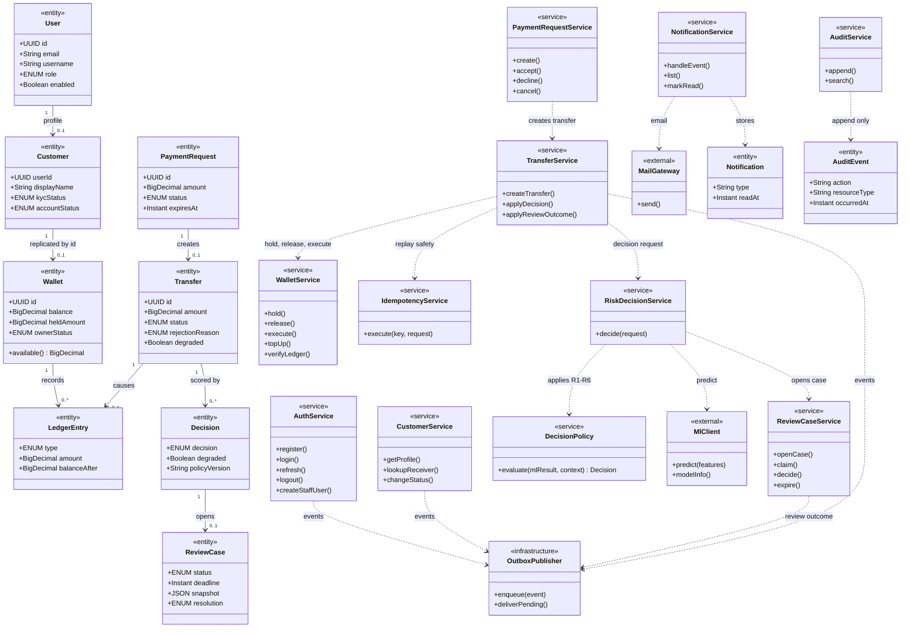

---

## 21. Frontend Design

### 21.1 Stack

React + TypeScript (strict) + Vite · MUI · TanStack Query · React Router · react-hook-form + zod · Recharts · Plotly.js `scattergl` through a partial WebGL bundle · Vitest + React Testing Library · MSW (API mocks) · Playwright (E2E, three flows) · API client generated from OpenAPI. English only. Served by an Nginx container; the Ingress routes `/` to it and `/api` to the Gateway (same origin, no CORS in production).

### 21.2 Architecture rules

- Feature-based folders (`features/transfers`, `features/requests`, `features/review`, …) with shared `components/` and `api/`.
- **Role-based route guards** (UX only, the backend enforces).
- Access token in memory, silent refresh on page load, a single in-flight refresh promise, retry once on 401.
- One `Idempotency-Key` per form submission, created when the form opens, kept on retry, regenerated after success.
- Amounts handled as strings or a decimal helper, never floating-point arithmetic.
- Every asynchronous screen has loading, empty, error and **degraded** states.
- Polling: notification badge every 20 s, review queue every 15 s, request detail while `PROCESSING` every 10 s, incoming pending requests every 5 s (pop-up).
- **MSW mocks generated from the OpenAPI specs** let the frontend build every screen before the backend is ready.

### 21.3 Screens

| Role | Screen | Content and behaviour |
|---|---|---|
| Public | Login, Register | Validation, generic error on bad credentials |
| CUSTOMER | **Dashboard** | Balance, available, held, last 5 transactions, pending incoming requests badge, quick actions |
| | **Send Money** | Identifier input → lookup → **confirm masked recipient** → amount → submit. Result screen per outcome (section 11.7 messages). |
| | **Withdraw Cash** (Should) | Pick a cash agent from the list, enter an amount, submit. Same outcome screens as Send Money. |
| | **Request Money** | Lookup, amount, note, submit |
| | **Requests** | Tabs *Incoming* and *Outgoing*, status chips |
| | **Incoming Request Pop-up** | Shown on any screen while a request is `PENDING`: requester (masked name), amount, note and a **2-minute countdown** (from the server's `expiresAt`, corrected with `serverTime`), Accept and Decline. **No risk information.** On expiry it closes and shows "Request expired". After Accept, the outcome message of section 11.7 is shown. |
| | **Request Detail (requester)** | Status timeline with countdown and Cancel. **No risk information.** |
| | **Transactions** | Filterable list, detail with timeline (Processing → Under review → Completed or Rejected) |
| | **Notifications** | Bell with unread count, full list |
| | **Profile** | View and update |
| ANALYST | **Review Queue** | Table: amount, parties (masked), received at, **SLA countdown**, priority, degraded flag, claimed by. Filters and auto-refresh. |
| | **Case Detail** | **Sender and receiver** panels side by side (profile, KYC, account age, recent activity). **Model panel:** probability, uncertainty score, prediction set, model version, optional explanation chart. Claim and release. Decision form: Approve or Reject, mandatory reason, confirmation dialog. |
| | **My Decisions** | History |
| | **ML Analytics** | See 21.4 |
| ADMIN | **Users** | List, search, block/unblock, create Analyst or Admin |
| | **Wallet Top-up** | Select user and amount |
| | **Audit Log** | Filterable, paginated |
| | **System** | Ledger verify button (shows invariants), link-out to Grafana |
| | **ML Analytics** | Same as analyst |

### 21.4 ML Analytics page

| Tab | Content | Data source |
|---|---|---|
| Embeddings | Scatter of PCA, t-SNE or UMAP (method toggle), colour by class, **errors highlighted**, toggle for uncertain points, tooltip with features | `GET /risk/viz/{method}` |
| Live decisions | Distribution of Approved/Review/Rejected, review rate over time, degraded ratio | `GET /risk/stats` |
| Model | Model name, version, metrics summary, conformal confidence level | `GET /risk/model-info` |

Embeddings are **precomputed offline** (a sample of roughly 5,000–10,000 points) and served as static JSON. Nothing is computed per request.

### 21.5 UX rules that protect the demo

- Customers never see a probability or a band at any point, only the outcome message.
- Outcome messages are defined once in a constants file and reused.
- An admin-only demo panel lists the seeded accounts so that the 5-minute demo needs no setup time.

---

## 22. Observability Contract

DevOps/MLOps owns Prometheus and Grafana. The application guarantees the following.

### 22.1 Health endpoints

| Endpoint | Meaning | Includes |
|---|---|---|
| `/actuator/health/liveness` | Process is alive | JVM only |
| `/actuator/health/readiness` | Can serve traffic | **Own database connection only. Never downstream services**, otherwise a downstream failure would remove every replica from rotation. |
| `/actuator/prometheus` | Metrics | Restricted to internal access |

Also required: graceful shutdown (`server.shutdown=graceful`, 30 s), stateless instances, and a **startup probe** (Spring cold start takes 30–60 s).

### 22.2 Metric catalog

Standard (Micrometer): `http_server_requests_seconds*`, JVM memory, GC and threads, `hikaricp_*`, `resilience4j_circuitbreaker_*`.

Custom metrics (names are a contract with the dashboards):

| Metric | Type | Labels | Service |
|---|---|---|---|
| `fintech_transfers_total` | counter | `status`, `reason` | Transaction |
| `fintech_payment_requests_total` | counter | `status` | Transaction |
| `fintech_wallet_lock_wait_seconds` | timer | | Transaction |
| `fintech_idempotent_replays_total` | counter | `endpoint` | Transaction |
| `fintech_stuck_transfers_reconciled_total` | counter | | Transaction |
| `fintech_decisions_total` | counter | `decision`, `degraded`, `scored` | Risk |
| `fintech_ml_call_seconds` | timer | `outcome` | Risk |
| `fintech_review_cases_open` | gauge | `priority` | Risk |
| `fintech_review_case_oldest_age_seconds` | gauge | | Risk |
| `fintech_review_decisions_total` | counter | `resolution` | Risk |
| `fintech_outbox_pending` | gauge | `service` | All with outbox |
| `fintech_outbox_delivery_failures_total` | counter | `service`, `target` | All with outbox |
| `fintech_notifications_sent_total` | counter | `channel`, `outcome` | Notification |
| `fintech_audit_events_total` | counter | `action` | Audit |

Derived signals (PromQL, owned by DevOps/MLOps): uncertain ratio (`PENDING_REVIEW` over all decisions), which drives the "ML uncertainty high" alert; degraded ratio; review queue age; outbox backlog.

### 22.3 Logs

JSON on stdout with `timestamp`, `level`, `service`, `correlationId`, `userId` (hashed), `message`. The Gateway generates the `correlationId` and every internal call propagates it.

---

## 23. Testing Strategy

| Level | Tooling | Must cover |
|---|---|---|
| Unit | JUnit 5, Mockito, AssertJ | **Decision policy R1–R6 including R1b (table-driven)**, request expiry, state machines, idempotency logic |
| Integration | Spring Boot Test + Testcontainers (PostgreSQL) | Wallet locking under concurrency, outbox delivery and deduplication, repositories, Flyway migrations |
| API contract | springdoc spec + schema validation; MSW handlers generated from the same spec | Frontend and backend cannot drift |
| Resilience | Resilience4j with a stub ML service | ML timeout → R2, circuit opens and recovers, review outcome retry |
| Frontend | Vitest + React Testing Library + MSW | Forms, role guards, risk card behaviour, idempotency key reuse |
| End-to-end | Playwright (run in CI) | (1) Register → send money → completed. (2) Payment request → accept within 2 minutes → review → analyst approves, plus an expired request. (3) Analyst rejects → funds released. |
| Invariants | `GET /admin/ledger/verify` | After every integration run and every chaos experiment |

**Mandatory concurrency test:** 50 parallel transfers among 3 wallets, then assert I1–I3 and `balance ≥ 0`.
**Coverage target:** at least 70% on the domain packages of `transaction` and `risk` (SonarQube gate), not a global percentage.
**Test utilities:** a small ML stub service that mimics the `/predict` contract, a seed tool, and a simulator that replays PaySim-like traffic through the **public API** (never directly into the databases).

---

## 24. Interfaces with Other Roles

This section states what the application **needs from** and **provides to** each role. It deliberately says nothing about how they do their work.

### 24.1 DevOps/MLOps

| The application provides | The application needs |
|---|---|
| One Docker image per service (multi-stage, non-root, `-XX:MaxRAMPercentage=75`) | Build and push to the registry from CI |
| Ports 8080–8086 and an environment-variable list per service | ConfigMaps and Secrets: DB URLs, users and passwords, JWT private key (Auth only), JWKS URL, service client credentials, SMTP host, ML URL, `risk.*` policy values |
| Liveness, readiness (database only), startup probe paths (section 22) | Probes configured accordingly, including a **startup probe** (cold start 30–60 s) |
| Graceful shutdown (30 s) | `terminationGracePeriodSeconds` of at least 40 s |
| `/actuator/prometheus` and the metric catalog | Scrape configuration, dashboards, alerts |
| Stateless services, multi-replica-safe jobs | HPA on Gateway, Transaction and Risk. Other services at 1–2 fixed replicas. |
| `/internal/**` not routed by the Gateway | NetworkPolicies limiting internal calls (optional hardening) |
| `GET /admin/ledger/verify` | Call it after every chaos experiment and record the result |
| Seed tool and simulator | Use them to prepare data for load tests |
| RabbitMQ (Should): outbox with a Publisher abstraction and an HTTP fallback | A broker deployment with persistence and a metrics endpoint, if the broker is adopted |

**Resource budget to validate together (rough, to be measured):**

| Item | Estimate |
|---|---|
| Spring service container | request 384 Mi, limit 640 Mi |
| 7 Spring services × 1–2 replicas | roughly 3.5–6 GB |
| PostgreSQL, MLflow, MinIO, Prometheus, Grafana, ML Serving, frontend | roughly 4–5 GB |
| **Total** | **roughly 8–11 GB**, so minikube needs at least 12 GB |

**PostgreSQL connection budget:** 6 services × up to 3 replicas × 5 pooled connections = 90 connections, so `max_connections` must be at least 150. Recompute if autoscaling goes higher.

**Load testing:** the load scenarios are written by ML Training in Locust against the public API. Each logical request must carry a **fresh** `Idempotency-Key`, reused on retry. Gateway rate limits must be configurable for load tests.

### 24.2 ML Training

| The application provides | The application needs |
|---|---|
| Features available **at inference time**: `type`, `amount`, sender and receiver balances before and after, plus derivable values (balance-drain ratio, receiver wallet age, recent transfer counts) | **The final feature list, by 25 Oct**, with exact names and units, and a note on leak-prone features (PaySim `new_balance_*` fields are tightly tied to the label) |
| The decision policy (section 11.7) so evaluation can be done at the **decision** level, not only per sample | The conformal prediction-set definition (confidence level and calibration set) |
| The review-rate metric as a first-class target | A **target review rate** recommendation (for example no more than 5% of traffic): an unusable review queue invalidates the system |
| | Visualisation artifacts: JSON for PCA, t-SNE, UMAP (about 5,000–10,000 sampled points with coordinates, true label, predicted label, uncertainty flag, a few feature values) |
| | Validation of the high-amount threshold used by rule R5 |
| | Locust scenarios: normal, high, overload, recovery |
| | **Primary metrics reported on the `TRANSFER` + `CASH_OUT` subset** (the traffic the application serves), with all-types results as secondary. The decision to keep the other types is explained in the report. |
| | Conformal calibration on the in-scope subset, or per type, so the coverage guarantee matches served traffic (in addition to the class-conditional calibration below) |
| | **Expected review rate on in-scope traffic**, because the all-types rate is diluted by easy rows. It is used to size the review queue and the uncertainty alert. |
| | Only features the application can compute identically at inference time (no PaySim balance-inconsistency features) |
| | Class-conditional (Mondrian) conformal prediction, with the confidence level tuned to the target review rate |
| | A time-based and account-disjoint evaluation split, so that scores and the review rate are realistic |

### 24.3 ML Serving

| The application provides | The application needs |
|---|---|
| A stub service that mimics the contract from day 1 | `POST /predict` exactly as in section 17 |
| | **Open:** confirm whether `/predict` accepts all five `type` values or only `TRANSFER` and `CASH_OUT` |
| Resilience configuration (section 17.3) | `GET /health/live` and `GET /health/ready` (ready only after model load) |
| Latency budget (section 17.4) | **p95 inference below 300 ms** at the agreed concurrency |
| | `GET /model-info` and `GET /viz/{pca\|tsne\|umap}` |
| | Prometheus metrics: inference-time histogram, request count, prediction-set sizes, uncertainty-score histogram, model-version gauge |
| | A `schema_version` in every response. A breaking change means a new major version, announced one week ahead. |

### 24.4 Frontend dependencies

The frontend consumes the OpenAPI specs and the error model in section 19. After the OpenAPI v1 freeze, changes are additive only.

### 24.5 Cross-role contract table

| Contract | Owner | Consumers | Frozen by |
|---|---|---|---|
| Dataset (**PaySim**, confirmed) | ML Training | All roles | Done |
| Feature list for inference | ML Training | Risk, ML Serving | 25 Oct |
| OpenAPI v1 for all Spring services | Backend | Frontend, DevOps/MLOps, ML Training (Locust) | 1 Nov |
| `/predict` schema | ML Serving with Backend | Risk | 1 Nov |
| Metric catalog | Backend (application metrics), DevOps/MLOps (infrastructure) | Dashboards and alerts | 15 Nov |
| Environment variable and secret list | Backend | DevOps/MLOps | 15 Nov |
| First real model in ML Serving | ML Training and ML Serving | Risk | 23 Nov |
| Application deployable on Kubernetes | Backend with DevOps/MLOps | All roles | 1 Dec |
| Feature freeze | Whole team | All roles | 20 Dec |

---

*End of document.*
