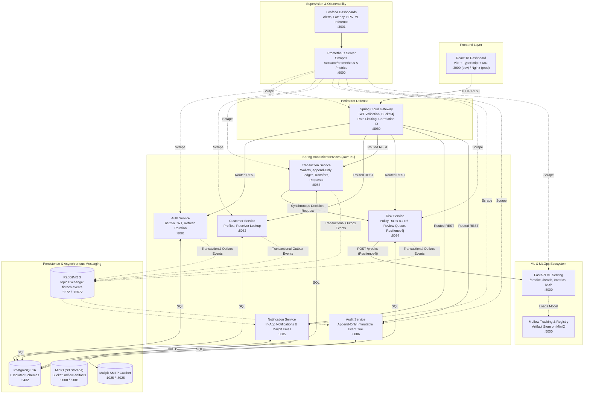

# FinTech Risk & MLOps Platform

> **High-Availability MLOps FinTech Platform** — A simulated real-time digital-wallet platform featuring microservices, machine learning fraud classification with conformal uncertainty quantification, Kubernetes orchestration, end-to-end CI/CD, and intelligent Prometheus/Grafana supervision.

**Academic Project — LSI 2026/2027 — Final Deadline: January 10, 2027**  
**Core Reference Document:** [APPLICATION_CONCEPTION_PLAN V2.1.md](APPLICATION_CONCEPTION_PLAN%20V2.1.md)

---

## 📑 Table of Contents
1. [System & Architecture Overview](#-system--architecture-overview)
2. [Network Allocations & Service Ports](#-network-allocations--service-ports)
3. [Team Roles & Task Map](#-team-roles--task-map)
4. [Quickstart: Local Development with Docker Compose](#-quickstart-local-development-with-docker-compose)
5. [Docker Containerization & "Golden Templates"](#-docker-containerization--golden-templates)
6. [Team Engineering Workflow & Git Standards](#-team-engineering-workflow--git-standards)
7. [Repository Layout](#-repository-layout)
8. [Documentation Index](#-documentation-index)

---

## 🏗️ System & Architecture Overview

The platform simulates a peer-to-peer digital wallet where customers can **send money** (Transfer), **withdraw cash** (Cash Out to agents), or **request money** (Payment Request).

Every monetary transaction is evaluated in real-time by a Machine Learning model served via FastAPI. The Risk Service evaluates the model prediction and its **conformal uncertainty set** to produce one of three outcomes:
* `APPROVED` — High confidence the transaction is legitimate. Executed instantly.
* `REJECTED` — High confidence the transaction is fraudulent. Declined instantly.
* `PENDING_REVIEW` — Model is uncertain (`prediction_set` contains both classes or empty), amount is high, or ML service is degraded. Funds are held and routed to a **Fraud Analyst** for human review within 24 hours.



---

## 🔌 Network Allocations & Service Ports

All microservices have dedicated, non-overlapping ports:

| Service / Component | Port | Technology | Responsible Role | Description |
|---------------------|------|------------|------------------|-------------|
| **React Frontend** | `3000` | React / Vite / Nginx | Role 2 | Client, Analyst & Admin UI |
| **API Gateway** | `8080` | Spring Cloud Gateway | Role 1 | Public entrance, rate limiting |
| **Auth Service** | `8081` | Spring Boot (JWT) | Role 1 | Credentials, RS256 JWKS |
| **Customer Service** | `8082` | Spring Boot | Role 1 | User profiles, masked receiver lookup |
| **Transaction Service** | `8083` | Spring Boot | Role 1 | Wallets, ledger, transfers, 2-min requests |
| **Risk Service** | `8084` | Spring Boot | Role 1 | Rules R1-R6, review queue, ML client |
| **Notification Service** | `8085` | Spring Boot | Role 1 / Role 2 | In-app notification & Mailpit dispatch |
| **Audit Service** | `8086` | Spring Boot | Role 1 / Role 2 | Immutable append-only audit trail |
| **FastAPI ML Serving** | `8000` | Python 3.11 / FastAPI | Role 5 | Model scoring (latency < 300ms) |
| **MLflow Server** | `5000` | MLflow | Role 3 | Experiment tracking & model registry |
| **PostgreSQL 16** | `5432` | Postgres Alpine | Role 3 (infra) | 6 isolated schemas |
| **MinIO API / UI** | `9000` / `9001` | MinIO | Role 3 (infra) | S3-compatible artifact storage |
| **RabbitMQ / Management** | `5672` / `15672` | RabbitMQ Alpine | Role 3 (infra) | Asynchronous outbox broker |
| **Mailpit SMTP / UI** | `1025` / `8025` | Mailpit | Role 3 (infra) | Local email catcher |
| **Prometheus** | `9090` | Prometheus | Role 3 (monitoring) | Metric collector & alerting engine |
| **Grafana** | `3001` | Grafana OSS | Role 3 (monitoring) | Operational & ML dashboards |

---

## 👥 Team Roles & Task Map

Detailed requirements for each role are formalized in [APPLICATION_CONCEPTION_PLAN V2.1.md](APPLICATION_CONCEPTION_PLAN%20V2.1.md) and synchronized with our [GitHub Issues #1 to #34](https://github.com/Oubay-S/fintech-mlops-platform/issues).

### 🔹 Role 1: Backend Engineer (Spring Boot)
* **Owned Services:** `api-gateway`, `auth-service`, `customer-service`, `transaction-service`, `risk-service` (+ shared `platform-starter`).
* **Key Tasks:**
  * Build the shared library `platform-starter` (RS256 JWT validation, `X-Correlation-Id`, RFC 7807 error format, outbox publisher).
  * **Auth Service:** RS256 JWT, rotating refresh tokens in httpOnly cookies, lockout after 5 failed attempts in 15 min (`429`), outbox `UserRegistered`.
  * **Customer Service:** Profile management, masked receiver lookup (`POST /customers/lookup`, 10 req/min).
  * **Transaction Service:** Double-entry append-only ledger (`ledger_entries`), enforce Invariants I1-I3 (money conservation), deadlock-free locking (`SELECT ... FOR UPDATE` in ascending wallet ID order), `Idempotency-Key` header handling (UUID), 2-minute live payment requests, background reconciler (every 30s).
  * **Risk Service:** Implement Decision Policy Rules R1 to R6, Resilience4j circuit breaker (timeout 1.5s), review case management with SLA deadline (24h).
  * **Observability:** Expose `/actuator/health/liveness`, `/actuator/health/readiness` (DB only), and `/actuator/prometheus` on all services.
* **GitHub Issues:** [#1](https://github.com/Oubay-S/fintech-mlops-platform/issues/1), [#2](https://github.com/Oubay-S/fintech-mlops-platform/issues/2), [#3](https://github.com/Oubay-S/fintech-mlops-platform/issues/3), [#4](https://github.com/Oubay-S/fintech-mlops-platform/issues/4), [#5](https://github.com/Oubay-S/fintech-mlops-platform/issues/5), [#6](https://github.com/Oubay-S/fintech-mlops-platform/issues/6), [#7](https://github.com/Oubay-S/fintech-mlops-platform/issues/7).

### 🔹 Role 2: Frontend & Delivery Engineer (React + Reporting)
* **Owned Component:** `frontend/` (React + Vite + MUI + TanStack Query) & Delivery.
* **Key Tasks:**
  * **Customer Views:** Balance cards, transfer form (masked recipient confirmation, idempotency key generation), transaction history with timeline.
  * **Live Payment Request Pop-Up (CRITICAL):** Poll incoming requests every 5s; render pop-up modal with **2-minute live countdown timer** (from server `expiresAt` & `serverTime`); Accept / Decline actions. **Zero risk scores or probability shown to customers!**
  * **Analyst Workbench:** Review queue with SLA countdown, side-by-side sender and receiver evidence, ML prediction panel (probability, conformal set, explanations), claim/release, Approve/Reject form with mandatory reason (>= 10 chars).
  * **ML Analytics Page:** Plotly.js (`scattergl`) rendering 2D embeddings (toggle between PCA, t-SNE, UMAP), color by class, error points highlighted.
  * **Project Delivery:** Consolidate final `README.md` report and record the official 5-minute video demonstration.
* **GitHub Issues:** [#8](https://github.com/Oubay-S/fintech-mlops-platform/issues/8), [#9](https://github.com/Oubay-S/fintech-mlops-platform/issues/9), [#10](https://github.com/Oubay-S/fintech-mlops-platform/issues/10), [#11](https://github.com/Oubay-S/fintech-mlops-platform/issues/11), [#12](https://github.com/Oubay-S/fintech-mlops-platform/issues/12), [#13](https://github.com/Oubay-S/fintech-mlops-platform/issues/13).

### 🔹 Role 3: DevOps & MLOps Engineer (@Oubay-S)
* **Owned Infrastructure:** `k8s/`, `infra/`, `.github/workflows/`, `docker-compose.yml`, Monitoring & Chaos.
* **Key Tasks:**
  * Maintain lightweight local dev stack (PostgreSQL with 6 schemas, MinIO, MLflow, RabbitMQ, Mailpit under 1.4 GB RAM).
  * Build CI/CD pipelines (GitHub Actions: Lint, Test, SonarCloud, Gitleaks, Trivy, Docker multi-stage build, GHCR push, automated rollback).
  * Orchestrate Kubernetes on Minikube (Kustomize `base` & `overlays`, Deployments, Services, ConfigMaps, Ingress, Spring `startupProbe`).
  * Configure Horizontal Pod Autoscaler (HPA) on Gateway, Transaction, Risk, and ML Serving.
  * Deploy `kube-prometheus-stack` via Helm, configure ServiceMonitors, write PrometheusRule alerts (CPU > 80%, Latency > 2s, Errors > 5%, Service Down, Uncertainty > 25%), and design Grafana dashboards.
  * Execute Chaos Engineering experiments (Pod-Kill during Locust load, demonstrate automatic recovery and verify zero money loss via `GET /admin/ledger/verify`).
* **GitHub Issues:** [#14](https://github.com/Oubay-S/fintech-mlops-platform/issues/14), [#15](https://github.com/Oubay-S/fintech-mlops-platform/issues/15), [#16](https://github.com/Oubay-S/fintech-mlops-platform/issues/16), [#17](https://github.com/Oubay-S/fintech-mlops-platform/issues/17), [#18](https://github.com/Oubay-S/fintech-mlops-platform/issues/18), [#19](https://github.com/Oubay-S/fintech-mlops-platform/issues/19), [#20](https://github.com/Oubay-S/fintech-mlops-platform/issues/20).

### 🔹 Role 4: ML Training Engineer (Data Science & Load Testing)
* **Owned Components:** `ml/common/`, `ml/training/`, `ml/visualization/`, `ml/load-tests/`.
* **Key Tasks:**
  * **Dataset Exploration:** Clean PaySim dataset (6.3M rows), handle extreme class imbalance (0.13% fraud in `TRANSFER` and `CASH_OUT`).
  * **Feature Engineering:** Avoid target leaks; compute realistic features (`amount`, balance drain ratio, velocity).
  * **Model Benchmark:** Benchmark 5 algorithms (Logistic Regression, Random Forest, XGBoost, SVM, MLP) on PR-AUC (primary metric), ROC-AUC, F1, MCC, Brier score.
  * **Statistical Validation:** Perform Friedman test across models, pairwise Wilcoxon signed-rank tests with Holm-Bonferroni correction, confidence intervals.
  * **Uncertainty Quantification:** Implement Conformal Prediction producing prediction sets (`{legit}`, `{fraud}`, `{legit, fraud}`). Calibrate threshold to keep human review rate <= 5%.
  * **2D Embeddings:** Precompute PCA, t-SNE, and UMAP 2D coordinates on 5,000–10,000 points and export to JSON files.
  * **Load Testing:** Author Locust scenarios in Python simulating 4 phases (Normal 20 RPS -> High 100 RPS -> Overload 300 RPS -> Recovery 20 RPS).
* **GitHub Issues:** [#21](https://github.com/Oubay-S/fintech-mlops-platform/issues/21), [#22](https://github.com/Oubay-S/fintech-mlops-platform/issues/22), [#23](https://github.com/Oubay-S/fintech-mlops-platform/issues/23), [#24](https://github.com/Oubay-S/fintech-mlops-platform/issues/24), [#25](https://github.com/Oubay-S/fintech-mlops-platform/issues/25), [#26](https://github.com/Oubay-S/fintech-mlops-platform/issues/26), [#27](https://github.com/Oubay-S/fintech-mlops-platform/issues/27).

### 🔹 Role 5: ML Serving Engineer (FastAPI & MLOps Pipeline)
* **Owned Components:** `ml/serving/`, `ml/pipeline/`.
* **Key Tasks:**
  * Deliver formal OpenAPI contract `POST /predict` in Week 1 (`docs/api/ml-predict-openapi.yaml`).
  * Build FastAPI microservice implementing `POST /predict` (target p95 latency < 300 ms), `GET /health/live`, `GET /health/ready` (returns 200 OK only after model is loaded), `GET /metrics`, `GET /model-info`, `GET /viz/{method}`.
  * Automate MLflow pipeline: Training -> Evaluation -> Statistical Validation -> Model Registry (`models:/fraud-detector/Production`).
  * Integrate dynamic model loading from MLflow Model Registry.
  * Build Grafana dashboard for ML inference latency and uncertainty distributions.
  * Write contract and parity tests between Spring Boot Risk Service and FastAPI.
* **GitHub Issues:** [#28](https://github.com/Oubay-S/fintech-mlops-platform/issues/28), [#29](https://github.com/Oubay-S/fintech-mlops-platform/issues/29), [#30](https://github.com/Oubay-S/fintech-mlops-platform/issues/30), [#31](https://github.com/Oubay-S/fintech-mlops-platform/issues/31), [#32](https://github.com/Oubay-S/fintech-mlops-platform/issues/32), [#33](https://github.com/Oubay-S/fintech-mlops-platform/issues/33), [#34](https://github.com/Oubay-S/fintech-mlops-platform/issues/34).

---

## 🚀 Quickstart: Local Development with Docker Compose

To allow all developers to write code without needing Kubernetes locally, the infrastructure layer runs in Docker Compose consuming **under 1.4 GB of RAM**.

### 1. Prerequisites
* **Docker Desktop** installed with WSL2 backend (Windows) or native Docker (Linux/macOS).
* Clone the repository:
  ```bash
  git clone https://github.com/Oubay-S/fintech-mlops-platform.git
  cd fintech-mlops-platform
  ```

### 2. Configure Environment
Copy the sample environment file:
```bash
cp .env.example .env
```
*(No edits are strictly needed for local development; passwords in `.env.example` are preconfigured).*

### 3. Launch Local Infrastructure
```bash
make up
```
*(Alternative: `docker compose up -d`)*

This single command starts:
1. **PostgreSQL 16:** Automatically initializes the 6 schemas (`auth`, `customer`, `transaction`, `risk`, `notification`, `audit`).
2. **MinIO Object Store:** Provisions S3 storage with the `mlflow-artifacts` bucket.
3. **MLflow Tracking Server:** Connected to Postgres backend store and MinIO.
4. **RabbitMQ Broker:** Pre-configured with management dashboard on port `15672`.
5. **Mailpit SMTP Catcher:** Captures development emails on port `8025`.

### 4. Service Access & Web Interfaces

| Service | Address | Default Credentials |
|---------|---------|---------------------|
| **MLflow Tracking UI** | [http://localhost:5000](http://localhost:5000) | None |
| **RabbitMQ Management** | [http://localhost:15672](http://localhost:15672) | `guest` / `guest` |
| **Mailpit (Email Catcher)** | [http://localhost:8025](http://localhost:8025) | None |
| **MinIO Console** | [http://localhost:9001](http://localhost:9001) | `minioadmin` / `changeme_minio` |
| **PostgreSQL 16** | `localhost:5432` | DB: `fintech`<br>User: `fintech_user`<br>Pass: `changeme_postgres` |

### 5. Stop the Stack
```bash
make down
```
To purge all database volumes and start completely fresh:
```bash
docker compose down -v
```

---

## 🐳 Docker Containerization & "Golden Templates"

All services must be containerized following strict production and security standards. Consult [docs/dockerfiles-templates.md](docs/dockerfiles-templates.md) for full instructions.

### Golden Rules:
1. **Multi-Stage Builds:** Never ship build tools (Maven, npm build kits, pip caches) in production runtime images.
2. **Non-Root Execution:** Containers must run under a dedicated system user (UID `1001`), never as `root`.
3. **JVM Memory Limits:** Every Spring Boot service must set:
   ```dockerfile
   ENV JAVA_OPTS="-XX:MaxRAMPercentage=75 -XX:+UseG1GC"
   ```
4. **Health & Metrics:** Every container must expose `/actuator/health` or `/health` and `/metrics`.

*(See [docs/dockerfiles-templates.md](docs/dockerfiles-templates.md) for copy-paste Dockerfiles for Spring Boot, FastAPI, and React).*

---

## 🤝 Team Engineering Workflow & Git Standards

To guarantee code quality and avoid merge conflicts, our repository enforces strict branch protection:
* **Direct pushes to `main` are prohibited.**
* Every modification must go through a dedicated branch and Pull Request.

### Standard 7-Step Workflow:
```
1. Pick Issue on GitHub Board ──> 2. git checkout -b feat/<role>-<topic>
      │
      ▼
3. Code & Test locally ──> 4. git push -u origin feat/<role>-<topic>
      │
      ▼
5. Open PR on GitHub with "Closes #ID" ──> 6. Peer Review & Merge ──> 7. git pull origin main
```

* **Branch Naming Standard:** `feat/<role>-<short-description>` (e.g. `feat/role1-auth-jwt`, `feat/role4-xgboost-benchmark`).
* **Conventional Commits:** `feat(...)`, `fix(...)`, `docs(...)`, `test(...)`, `ci(...)`, `chore(...)`.
* **Automatic Issue Closure:** In your PR description, write:
  ```markdown
  Closes #3
  ```
  GitHub will automatically close Issue #3 when your PR is merged!

*(Read our full [Team Workflow Guide](docs/workflow-guide.md) for details).*

---

## 📂 Repository Layout

```
fintech-mlops-platform/
├── services/               # Microservices Spring Boot (Role 1 & Role 2)
│   ├── api-gateway/        # Spring Cloud Gateway (:8080)
│   ├── auth-service/       # Authentication, RS256 JWKS (:8081)
│   ├── customer-service/   # Profiles & receiver lookup (:8082)
│   ├── transaction-service/# Wallets, double-entry ledger, transfers (:8083)
│   ├── risk-service/       # Decision policy R1-R6, review queue (:8084)
│   ├── notification-service/# Notifications & Mailpit email (:8085)
│   └── audit-service/      # Append-only audit trail (:8086)
├── ml/                     # ML & Data Science (Roles 4 & 5)
│   ├── common/             # Preprocessing & shared PaySim feature logic
│   ├── training/           # Model benchmark & statistical tests (Friedman/Wilcoxon)
│   ├── pipeline/           # MLflow training -> evaluation -> registry pipeline
│   ├── serving/            # FastAPI model serving service (:8000)
│   ├── visualization/      # Precomputed PCA, t-SNE, UMAP coordinates (JSON)
│   └── load-tests/         # Python Locust load testing scenarios
├── frontend/               # React 18 + Vite dashboard (Role 2)
├── k8s/                    # Kubernetes manifests (Role 3)
│   ├── base/               # Kustomize base deployments & services
│   ├── overlays/dev/       # Development overlays (reduced replicas)
│   ├── overlays/prod/      # Production overlays (HPA & probes active)
│   ├── data/               # Postgres, MinIO, MLflow manifests
│   ├── monitoring/         # Prometheus, Alertmanager, Grafana values & dashboards
│   └── ingress/            # Unified Nginx Ingress routing
├── infra/                  # Infrastructure scripts & SQL initializations
│   └── docker/postgres/    # Automatic 6-schema initialization script
├── scripts/                # Repository maintenance & automation scripts
├── docs/                   # Engineering standards, conventions & guides
│   ├── conventions.md      # Port allocations, image standards, week 1 decisions
│   ├── workflow-guide.md   # Step-by-step GitHub issues & PR workflow guide
│   ├── local-dev.md        # Detailed Docker Compose local dev guide
│   └── dockerfiles-templates.md # Official Dockerfile templates for all services
├── docker-compose.yml      # Local dev stack (Postgres, MinIO, MLflow, Rabbit, Mailpit)
├── Makefile                # Raccourcis make up / down / logs
└── README.md               # Main project documentation (this file)
```

---

## 📚 Documentation Index

1. **Architecture & System Specification:** [APPLICATION_CONCEPTION_PLAN V2.1.md](APPLICATION_CONCEPTION_PLAN%20V2.1.md)
2. **Technical Conventions & Port Standards:** [docs/conventions.md](docs/conventions.md)
3. **Team Workflow & Pull Request Guide:** [docs/workflow-guide.md](docs/workflow-guide.md)
4. **Local Infrastructure Guide:** [docs/local-dev.md](docs/local-dev.md)
5. **Dockerfile Containerization Templates:** [docs/dockerfiles-templates.md](docs/dockerfiles-templates.md)
6. **Contribution Guidelines:** [CONTRIBUTING.md](CONTRIBUTING.md)
7. **Interactive Project Roadmap:** [GitHub Projects Kanban Board](https://github.com/users/Oubay-S/projects/1)

---

## 📄 License
Academic project — LSI 2026/2027 — All rights reserved.
