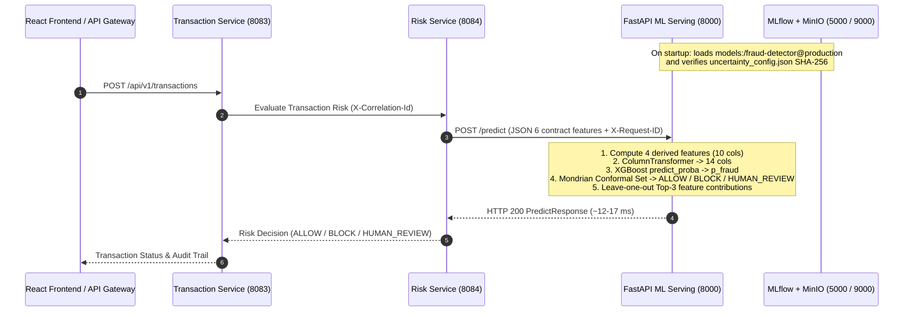

# MLOps & ML Serving — Cross-Team Handoff & Integration Guide (Role 5 → All Roles)

**Author / Owner:** Role 5 — MLOps & ML Serving Engineer  
**Target Audience:**
- **Role 1 (Backend / Spring Boot Microservices):** Risk Service & API Gateway integration with `POST /predict` and `GET /model-info`
- **Role 2 (Frontend / React Dashboard):** Model analytics (`GET /model-info`) and 2D embedding visualizations (`GET /viz/{pca,tsne,umap}`)
- **Role 3 (DevOps & Cloud Infrastructure):** Docker Compose, CI/CD pipelines, Kubernetes manifests, K8s Seeder Job, and Prometheus/Grafana observability
- **Role 4 (Data Scientist):** Certified 6/6 Golden Parity verification (`max |Δ| = 0.0`) and Phase 9 Locust load-testing orientation

**Status:** Production-Ready · All 5 Integration Phases Verified · 70/70 Automated Tests Passing

---

## 1. End-to-End Architecture & MLOps Lifecycle

### 1.1 Reproducible MLOps Pipeline (`Training → Evaluation → Statistical Validation → Registry → Deployment`)

```mermaid
flowchart LR
    subgraph Training & Evaluation ["1. Benchmark & Conformal Calibration (Role 4)"]
        A["PaySim Dataset (5 Types / 14 Features)"] --> B["5-Model CV Benchmark (lr, rf, xgb, svm, mlp)"]
        B --> C["Statistical Tests (Friedman p=2.9e-12, Wilcoxon/Holm p=0.00061)"]
        C --> D["Champion XGBoost + Mondrian Conformal (99% Confidence)"]
    end

    subgraph MLOps Governance ["2. MLflow Tracking, Gate & Registry (Role 5)"]
        D -->|populate_mlflow.py| E["MLflow Experiment: paysim-fraud-benchmark"]
        E -->|Register Model| F["fraud-detector v1 (@candidate)"]
        F -->|validate_gate.py| G{"Automated Quality Gate (Exit 0?)"}
        G -->|promote_model.py| H["@staging"]
        H -->|promote_model.py| I["@production (rotates old to @previous)"]
    end

    subgraph Production Serving ["3. High-Availability FastAPI Serving (Role 5 / Role 3)"]
        I -->|S3 + Registry Load| J["fintech-ml-serving:latest (Port 8000, UID 1001)"]
        J --> K["POST /predict (ALLOW | BLOCK | HUMAN_REVIEW)"]
        J --> L["GET /model-info & GET /viz/{pca,tsne,umap}"]
        J --> M["GET /metrics (Prometheus) & /health/{live,ready}"]
    end
```



### 1.2 Runtime Transaction Scoring Sequence (`Spring Boot Risk Service ↔ FastAPI ML Serving`)



---

## 2. Canonical URLs & Ports Reference Table

Keep this table handy when testing locally or configuring inter-service communication:

| Service | Host URL (Browser / Host CLI) | Docker Internal URL (`fintech_default` network) | Default Credentials / Notes |
| :--- | :--- | :--- | :--- |
| **FastAPI ML Serving API** | `http://localhost:8000` | `http://fintech-ml-serving:8000` (or `http://ml-serving:8000`) | No auth unless `INTERNAL_API_KEY` is set |
| **FastAPI Swagger UI (Interactive)** | `http://localhost:8000/docs` | `http://fintech-ml-serving:8000/docs` | Test all endpoints directly in browser |
| **FastAPI ReDoc UI** | `http://localhost:8000/redoc` | `http://fintech-ml-serving:8000/redoc` | Clean API documentation view |
| **OpenAPI 3.0.3 JSON Schema** | `http://localhost:8000/openapi.json` | `http://fintech-ml-serving:8000/openapi.json` | Canonical source: [`docs/api/ml-predict-openapi.yaml`](docs/api/ml-predict-openapi.yaml) |
| **Prometheus Metrics** | `http://localhost:8000/metrics` | `http://fintech-ml-serving:8000/metrics` | Scraped by Prometheus |
| **MLflow Tracking & Registry UI** | `http://localhost:5000` | `http://mlflow:5000` | Experiment: `paysim-fraud-benchmark`, Model: `fraud-detector` |
| **MinIO S3 API** | `http://localhost:9000` | `http://minio:9000` | Bucket: `mlflow-artifacts` |
| **MinIO Web Console** | `http://localhost:9001` | `http://minio:9001` | Defined in `.env` (`MINIO_ROOT_USER` / `MINIO_ROOT_PASSWORD`) |
| **PostgreSQL Database** | `localhost:5432` *(or `5433` on Windows)* | `postgres:5432` | Defined in `.env` (`POSTGRES_USER` / `POSTGRES_PASSWORD`) |

---

## 3. Orientation for Backend Developer (Role 1 — Spring Boot Risk Service)

### 3.1 Endpoint Summary for Backend Integration

| Method & Path | Purpose | Expected Latency | Auth (`X-Internal-Api-Key`) |
| :--- | :--- | :--- | :--- |
| `POST /predict` | Score a single transaction and return conformal decision (`ALLOW`, `BLOCK`, `HUMAN_REVIEW`) | **12–35 ms** (SLA $< 50\text{ ms}$) | Required if `INTERNAL_API_KEY` is configured |
| `GET /model-info` | Retrieve active champion model metadata, conformal thresholds, and validation metrics | **< 5 ms** | Required if `INTERNAL_API_KEY` is configured |
| `GET /health/ready` | Verify ML model is loaded in memory before routing traffic | **< 2 ms** | Exempt (Always public) |
| `GET /health/live` | Process liveness check | **< 2 ms** | Exempt (Always public) |

### 3.2 `POST /predict` — Request Contract

- **URL:** `http://ml-serving:8000/predict` (Docker/K8s) or `http://localhost:8000/predict` (Local)
- **Headers:**
  - `Content-Type: application/json`
  - `X-Request-ID: <UUID>` *(optional; if omitted, `request_id` from body is echoed back)*
  - `X-Correlation-Id: <UUID>` *(optional; echoed back on response for distributed tracing)*
  - `X-Internal-Api-Key: <secret>` *(only if `INTERNAL_API_KEY` is non-empty in environment)*

#### Request JSON Body (`PredictRequest`)
```json
{
  "schema_version": "1.0",
  "request_id": "550e8400-e29b-41d4-a716-446655440002",
  "features": {
    "type": "TRANSFER",
    "amount": 250000.0,
    "sender_old_balance": 250000.0,
    "sender_new_balance": 0.0,
    "receiver_old_balance": 0.0,
    "receiver_new_balance": 250000.0
  }
}
```

#### Field Constraints (Strictly Validated by Pydantic)
- `schema_version`: Must be `"1.0"`.
- `request_id`: Valid UUID string.
- `features.type`: Enum — one of `"PAYMENT"`, `"TRANSFER"`, `"CASH_OUT"`, `"DEBIT"`, `"CASH_IN"`.
- `features.amount`, `sender_old_balance`, `sender_new_balance`, `receiver_old_balance`, `receiver_new_balance`: Float `>= 0.0` (non-negative, finite).
- **Important:** Do **not** send derived features (`balance_drain_ratio`, etc.); FastAPI computes the 4 derived features automatically via `ml.common.preprocessing.build_features()` to guarantee 100% training-serving parity.

### 3.3 `POST /predict` — Response Contract (`HTTP 200 OK`)

```json
{
  "schema_version": "1.0",
  "request_id": "550e8400-e29b-41d4-a716-446655440002",
  "fraud_probability": 0.999997,
  "action": "BLOCK",
  "uncertainty": {
    "method": "mondrian_conformal",
    "confidence_level": 0.99,
    "prediction_set": ["fraud"],
    "score": 0.000063
  },
  "explanations": [
    {
      "feature": "balance_drain_ratio",
      "contribution": 0.999985
    },
    {
      "feature": "sender_new_balance",
      "contribution": 0.01421
    },
    {
      "feature": "sender_zero_after",
      "contribution": 0.00812
    }
  ],
  "model": {
    "name": "fraud-detector",
    "version": "1",
    "stage": "Production",
    "alias": "production"
  },
  "inference_ms": 14.379
}
```

### 3.4 How Backend Risk Service Should Handle `action` & Error Codes

1. **Decision Routing (`response.action`):**
   - `"ALLOW"`: Singleton `prediction_set == ["legit"]` and low uncertainty (`score < 0.50`). Approve transaction automatically.
   - `"BLOCK"`: Singleton `prediction_set == ["fraud"]`. Reject/block transaction immediately and emit fraud alert.
   - `"HUMAN_REVIEW"`: Either `prediction_set == []` (empty set — pattern outside calibrated distribution, e.g., high-amount legitimate transfer) or `prediction_set == ["legit", "fraud"]` (ambiguous set). Place transaction in `PENDING_REVIEW` state for compliance analyst inspection.
2. **Error Handling (`ErrorResponse` envelope):**
   - `HTTP 400 Bad Request` (`INVALID_JSON_PAYLOAD` / `UNSUPPORTED_SCHEMA_VERSION`)
   - `HTTP 401 Unauthorized` (`UNAUTHORIZED` — missing or invalid `X-Internal-Api-Key`)
   - `HTTP 422 Unprocessable Entity` (`VALIDATION_ERROR` — e.g. negative balance or invalid `type`)
   - `HTTP 503 Service Unavailable` (`MODEL_NOT_READY` — MLflow model still loading on pod startup; Spring Boot `WebClient`/`RestClient` should retry with exponential backoff or trigger circuit-breaker fallback).

---

## 4. Orientation for Frontend Engineer (Role 2 — React Dashboard)

### 4.1 Model Metadata Endpoint (`GET /model-info`)
Used to populate the **"ML Model Governance & Conformal Calibration"** panel on the dashboard:
- Returns `model` (`name`, `version`, `stage`, `alias`, `algorithm`, `run_id`, `trained_at`), `conformal_config` (`method`, `confidence_level`, `target_review_rate`, `q_hat_fraud`, `q_hat_legit`), `metrics_summary` (`roc_auc`, `pr_auc`, `f1`, `precision`, `recall`, `mcc`, `brier_score`, `expected_review_rate`, `inference_p95_ms`), `contract_features` (6), and `derived_features` (4).

### 4.2 2D Embedding Visualization Endpoint (`GET /viz/{method}`)
- **Supported `{method}` values:** `pca`, `tsne`, `umap`
- **Example URL:** `GET /viz/umap`
- **Response (`HTTP 200 OK`):** Returns up to `2000` stratified PaySim points:
  ```json
  {
    "schema_version": "1.0",
    "method": "umap",
    "n_points": 2000,
    "generated_at": "2026-10-31T23:41:10.123456+00:00",
    "points": [
      {
        "x": -4.301976,
        "y": 3.587642,
        "true_label": 0,
        "predicted_label": 0,
        "uncertain": false,
        "error": false,
        "type": "CASH_OUT",
        "amount": 239538.64,
        "balance_drain_ratio": 0.59756
      }
    ]
  }
  ```

---

## 5. Orientation for Data Scientist (Role 4 — Parity Verification & Phase 9 Locust Load Tests)

### 5.1 Certified Golden Parity Results (`6 / 6 Exact Match`)
All 6 test cases in [`ml/training/package/parity_cases.json`](ml/training/package/parity_cases.json) have been verified against the running `fintech-ml-serving:latest` container loading `models:/fraud-detector@production` from MLflow/MinIO:

| # | Case Name | HTTP | Expected Action | Actual Action | `prediction_set` | `fraud_probability` (`|Δ|`) | `uncertainty.score` (`|Δ|`) | Latency (`inference_ms`) |
| :-: | :--- | :-: | :---: | :---: | :---: | :---: | :---: | :---: |
| 1 | `legit_partial_transfer` | `200` | `ALLOW` | `ALLOW` | `["legit"]` | `0.000004` (`0.0`) | `0.000075` (`0.0`) | `34.77 ms` |
| 2 | `fraud_full_drain` | `200` | `BLOCK` | `BLOCK` | `["fraud"]` | `0.999997` (`0.0`) | `0.000063` (`0.0`) | `14.38 ms` |
| 3 | `high_amount_legit` | `200` | `HUMAN_REVIEW` | `HUMAN_REVIEW` | `[]` | `0.000057` (`0.0`) | `0.850000` (`0.0`) | `13.78 ms` |
| 4 | `cash_out_withdrawal` | `200` | `ALLOW` | `ALLOW` | `["legit"]` | `0.000005` (`0.0`) | `0.000096` (`0.0`) | `14.22 ms` |
| 5 | `fraud_full_drain_1m` | `200` | `BLOCK` | `BLOCK` | `["fraud"]` | `0.999998` (`0.0`) | `0.000032` (`0.0`) | `12.06 ms` |
| 6 | `small_partial_transfer` | `200` | `ALLOW` | `ALLOW` | `["legit"]` | `0.000005` (`0.0`) | `0.000100` (`0.0`) | `17.21 ms` |

- **Maximum Probability Deviation:** $\max |\Delta p| = 0.000000$
- **Maximum Uncertainty Score Deviation:** $\max |\Delta \text{score}| = 0.000000$

### 5.2 Running Phase 9 Locust Load Tests
The serving container is ready for Phase 9 Locust load testing (`ml/load-tests/`):
- **Target Host:** `http://localhost:8000` (local Docker) or `http://fintech-ml-serving:8000` (inside cluster/network)
- **Primary Load Endpoint:** `POST /predict`
- **Health Check Endpoint:** `GET /health/ready`
- **Prometheus Metrics Endpoint:** `GET /metrics` (use `ml_inference_duration_seconds_bucket` and `ml_http_request_duration_seconds_bucket` to cross-verify p50/p95/p99 latencies during load tests).

---

## 6. Orientation for DevOps Engineer (Role 3 — CI/CD & Kubernetes Integration)

### 6.1 Understanding CI (Ephemeral Validation) vs CD (Cluster Persistence)

```mermaid
flowchart TD
    subgraph CI ["1. GitHub Actions CI (Pull Request — Ephemeral VM)"]
        CI1["Run ruff & pytest ml/ (70 unit/integration tests)"]
        CI2["Optional: Start ephemeral compose stack in runner"]
        CI3["Run populate_mlflow -> validate_gate -> promote_model"]
        CI4["Destroy VM after job completes (Proves code & gate validity)"]
        CI1 --> CI2 --> CI3 --> CI4
    end

    subgraph CD ["2. Kubernetes CD / Cluster Bootstrap (Persistent State)"]
        CD1["Deploy PostgreSQL, MinIO, create-buckets, and MLflow pods"]
        CD2["Run K8s Job: mlflow-seed-job (populate_mlflow + validate_gate + promote_model)"]
        CD3["MLflow in K8s now holds fraud-detector@production permanently"]
        CD4["Deploy fintech-ml-serving Deployment (2-6 replicas via HPA)"]
        CD1 --> CD2 --> CD3 --> CD4
    end
```



### 6.2 GitHub Actions CI Integration Snippet
In `.github/workflows/ci.yml`, the `ml-services` job runs `pytest ml/ -v` (which executes all 70 tests across `ml/training/tests`, `ml/pipeline/tests`, and `ml/serving/tests`). To also run an end-to-end MLOps Quality Gate check in CI:

```yaml
      - name: Run MLOps Smoke Pipeline & Quality Gate Check
        run: |
          python -m ml.pipeline.run_pipeline --synthetic --synthetic-rows 600
```
*(Note: `--synthetic` tests the full MLflow logging $\rightarrow$ `validate_gate.py` $\rightarrow$ `@staging` promotion pipeline in 3 seconds using a local temporary tracking store, while verifying that synthetic models are strictly blocked from `@production`).*

### 6.3 Kubernetes Manifests Reference (For `k8s/base/`)

#### A. Kubernetes Seeder & Promotion Job (`mlflow-seed-job.yaml`)
Because the Kubernetes PostgreSQL and MinIO volumes start empty on first cluster deployment, include a Kubernetes `Job` that seeds MLflow and promotes the verified Champion model to `@production`:

```yaml
apiVersion: batch/v1
kind: Job
metadata:
  name: mlflow-seed-job
spec:
  backoffLimit: 3
  template:
    spec:
      securityContext:
        runAsNonRoot: true
        runAsUser: 1001
      restartPolicy: OnFailure
      containers:
        - name: mlflow-seeder
          image: fintech-ml-serving:latest
          imagePullPolicy: IfNotPresent
          command:
            - /bin/sh
            - -c
            - |
              python -m ml.pipeline.fetch_model &&
              python -m ml.pipeline.populate_mlflow --tracking-uri http://mlflow:5000 &&
              python -m ml.pipeline.validate_gate --alias candidate --tracking-uri http://mlflow:5000 &&
              python -m ml.pipeline.promote_model --from-alias candidate --to-alias staging --tracking-uri http://mlflow:5000 &&
              python -m ml.pipeline.promote_model --from-alias staging --to-alias production --tracking-uri http://mlflow:5000
          env:
            - name: MLFLOW_TRACKING_URI
              value: "http://mlflow:5000"
            - name: MLFLOW_S3_ENDPOINT_URL
              value: "http://minio:9000"
            - name: AWS_ACCESS_KEY_ID
              valueFrom:
                secretKeyRef:
                  name: minio-credentials
                  key: root-user
            - name: AWS_SECRET_ACCESS_KEY
              valueFrom:
                secretKeyRef:
                  name: minio-credentials
                  key: root-password
```
*(Note: [`ml/serving/Dockerfile`](ml/serving/Dockerfile) copies `ml/common`, `ml/pipeline`, `ml/training/results`, `ml/training/package`, and `ml/serving` and pre-creates `/app/ml/data/processed` owned by UID `1001`, so `fintech-ml-serving:latest` can execute `mlflow-seed-job` directly without extra volume mounts).*

#### B. Prometheus Metrics Exposed on `GET /metrics` (Port `8000`)
Configure Prometheus to scrape `http://fintech-ml-serving:8000/metrics` every `15s`:

| Metric Name | Type | Labels | Description |
| :--- | :--- | :--- | :--- |
| `ml_http_requests_total` | Counter | `method`, `route`, `status` | Total HTTP requests handled by FastAPI |
| `ml_http_request_duration_seconds` | Histogram | `method`, `route` | End-to-end HTTP request latency distribution |
| `ml_ready` | Gauge | *(none)* | Readiness state (`1` when `@production` model is loaded & verified, `0` otherwise) |
| `ml_model_load_seconds` | Gauge | *(none)* | Wall-clock duration in seconds of the latest MLflow model load |
| `ml_model_info` | Gauge | `model_name`, `version`, `stage`, `alias` | Constant `1` gauge identifying the currently active model in memory |
| `ml_inference_duration_seconds` | Histogram | `model_version` | Pure ML + conformal scoring latency |
| `ml_predictions_total` | Counter | `action`, `prediction_set`, `model_version` | Predictions broken down by `ALLOW`, `BLOCK`, `HUMAN_REVIEW` and set composition |
| `ml_human_review_requests_total` | Counter | `reason`, `model_version` | `HUMAN_REVIEW` triggers (`empty_set`, `ambiguous_set`, `high_uncertainty_score`) |
| `ml_prediction_set_size` | Histogram | `model_version` | Distribution of conformal prediction set sizes $|\Gamma(x)| \in \{0, 1, 2\}$ |
| `ml_uncertainty_score` | Histogram | `model_version` | Distribution of conformal uncertainty scores $\in [0, 1]$ |
