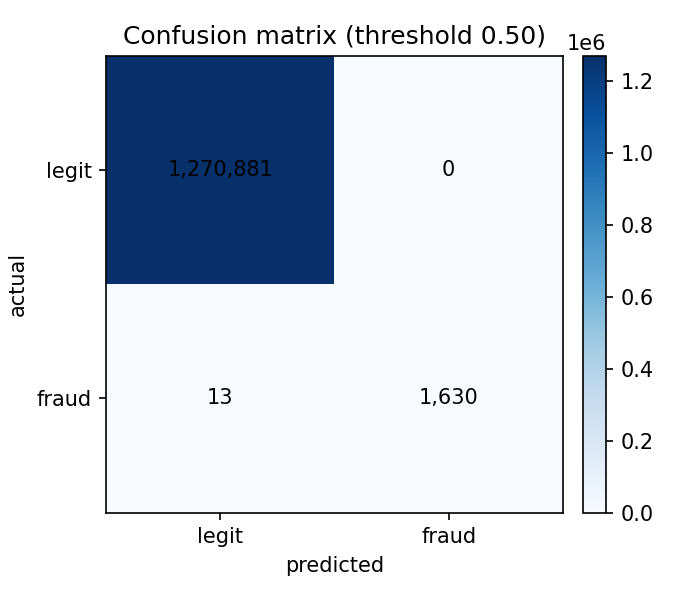
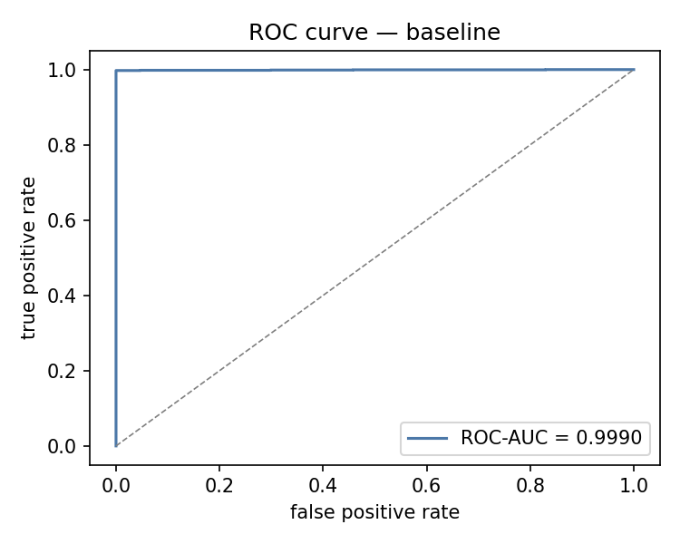
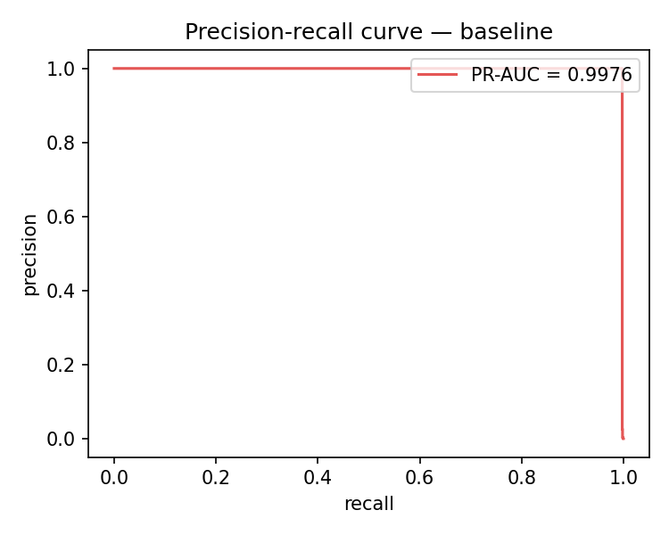
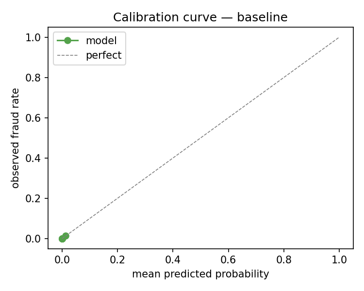
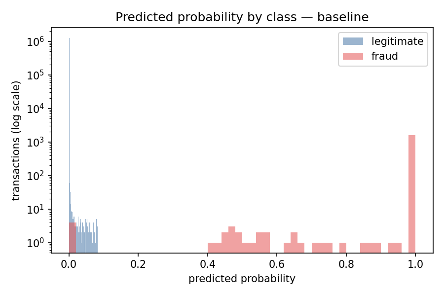

# Logistic Regression Baseline — full data

**Generated:** 2026-10-27 · **Script:** `ml/training/scripts/run_baseline.py`
**Model:** LogisticRegression (lbfgs, max_iter=1000, no class weights)
**Preprocessing:** shared `ml/common/preprocessing.py` (14 features: 9 scaled numeric + 5 one-hot `type`)

## Split (primary protocol)

| Split | Rows | Fraud rate |
|---|---|---|
| Fit | 4,072,076 | 0.1291% |
| Calibration | 1,018,020 | 0.1291% |
| Test | 1,272,524 | 0.1291% |

## Test metrics — threshold 0.5

| Metric | Value |
|---|---|
| Accuracy | 1.0000 |
| Precision | 1.0000 |
| Recall | 0.9921 |
| F1 | 0.9960 |
| ROC-AUC | 0.9990 |
| PR-AUC | 0.9976 |
| MCC | 0.9960 |
| Brier | 0.000007 |
| Predicted positive rate | 0.128% |

Confusion matrix at 0.5: **TN 1,270,881 · FP 0 · FN 13 · TP 1,630**

Reference — always predicting "legitimate" gives accuracy 0.9987, recall 0, F1 0: **accuracy alone is meaningless here**.

## Calibration-selected operating point

Best F1 threshold on the **calibration** set: **0.4074**.

| Metric | Value |
|---|---|
| Precision | 1.0000 |
| Recall | 0.9976 |
| F1 | 0.9988 |
| MCC | 0.9988 |

## Slice metrics — threshold 0.5

| Slice | Rows | Frauds | Fraud rate | ROC-AUC | PR-AUC | Recall | Precision | F1 |
|---|---:|---:|---:|---:|---:|---:|---:|---:|
| All types | 1,272,524 | 1,643 | 0.1291% | 0.9990 | 0.9976 | 0.9921 | 1.0000 | 0.9960 |
| TRANSFER | 106,527 | 845 | 0.7932% | 0.9999 | 0.9989 | 0.9882 | 1.0000 | 0.9940 |
| CASH_OUT | 447,193 | 798 | 0.1784% | 0.9988 | 0.9963 | 0.9962 | 1.0000 | 0.9981 |
| TRANSFER + CASH_OUT | 553,720 | 1,643 | 0.2967% | 0.9992 | 0.9976 | 0.9921 | 1.0000 | 0.9960 |
| App-valid (in-scope, valid amount) | 56,349 | 1,636 | 2.9033% | 1.0000 | 1.0000 | 0.9945 | 1.0000 | 0.9972 |
| Rule-positive (app-valid) | 1,608 | 1,608 | 100.0000% | n/a | n/a | 1.0000 | 1.0000 | 1.0000 |
| Hard subset (app-valid) | 54,741 | 28 | 0.0511% | 1.0000 | 1.0000 | 0.6786 | 1.0000 | 0.8085 |

**Read this table carefully.** `App-valid` applies the app's validation (`amount > 0`, `amount <= sender_old_balance`) and is the serving estimate; the full `TRANSFER + CASH_OUT` slice includes rows the app rejects before ML. `Rule-positive` is the deterministic `amount == sender_old_balance` subset; `Hard subset` is the rule-negative remainder.

## Rule baseline — deterministic `amount == sender_old_balance`

| Population | Selected | TP | FP | Precision | Recall | F1 |
|---|---:|---:|---:|---:|---:|---:|
| All serving (TRANSFER + CASH_OUT) | 1,611 | 1,611 | 0 | 1.0000 | 0.9805 | 0.9902 |
| App-valid | 1,608 | 1,608 | 0 | 1.0000 | 0.9829 | 0.9914 |

## Serving-consistent balances — app-computed `new = old ± amount`

| Slice | Rows | Frauds | ROC-AUC | PR-AUC | Recall | Precision | F1 |
|---|---:|---:|---:|---:|---:|---:|---:|
| App-valid | 56,349 | 1,636 | 1.0000 | 1.0000 | 0.9884 | 1.0000 | 0.9942 |
| Hard subset (app-valid) | 54,741 | 28 | 1.0000 | 1.0000 | 0.3214 | 1.0000 | 0.4865 |

## Preliminary ablation (Logistic Regression only)

| Feature set | Features | ROC-AUC | PR-AUC | F1 | Recall |
|---|---|---|---|---|---|
| Full contract | 14 | 0.9990 | 0.9976 | 0.9988 | 0.9976 |
| No new balances | 9 | 0.9498 | 0.2934 | 0.3541 | 0.2928 |
| Amount only | 6 | 0.8903 | 0.0094 | 0.0361 | 0.0572 |

The full contract model is near-perfect because the new-balance/equality features encode the simulator's drain rule. The restricted set removes those features but still contains `amount` and `sender_old_balance`, which define the rule; a tree can approximate the equality boundary, so the LR-only drop is not sufficient evidence. Phase 4 adds a rule-blind protocol and the hard-subset table for all five algorithms.

## Inference timing

| Measure | Value |
|---|---|
| Batch (amortised) | 0.025 µs/row |
| Single row p50 | 0.074 ms |
| Single row p95 | 0.078 ms |

## Figures

## Interpretation

- PaySim's near-deterministic drain rule makes a linear baseline very strong; high scores are expected and are a **dataset property**, not evidence of real-world capability.
- **The app-valid slice is the serving estimate.** The app's `available >= amount` validation removes ~90% of PaySim rows before ML; the remaining traffic has a **2.903%** fraud rate (not 0.129%). The full `TRANSFER + CASH_OUT` slice is a sensitivity, not the serving population.
- **The rule baseline is precision 1.0 / recall 0.9805 (all serving test) / 0.9829 (app-valid test).** The hard subset (rule-negative frauds) is the real test of the model; the headline AUC is the rule.
- **Serving-consistent balances matter.** The app computes `new = old ± amount`; on the app-valid hard subset the recall falls from 0.679 (raw PaySim balances) to 0.321. Report the serving-consistent number, not only the raw one.
- The calibration curve and Brier score are reported as-is; class weighting/resampling is evaluated in the Phase 4 benchmark, not hidden in the baseline.
- The threshold 0.5 is arbitrary under 2.903% app-valid prevalence; the calibration-selected threshold above is a first honest operating point. The final policy (allow/decline/review) will use Mondrian conformal prediction sets in Phase 6.
- Next: Phase 4 — five algorithms (LR, RF, XGBoost, SVM, MLP), paired CV × seeds, contract/restricted/rule-blind protocols, and the app-valid hard-subset table.

## Artifacts

- `ml/training/docs/baseline_metrics.json`
- `ml/data/processed/baseline_model.joblib` (git-ignored)
- `ml/training/docs/figures/baseline_*.png`
