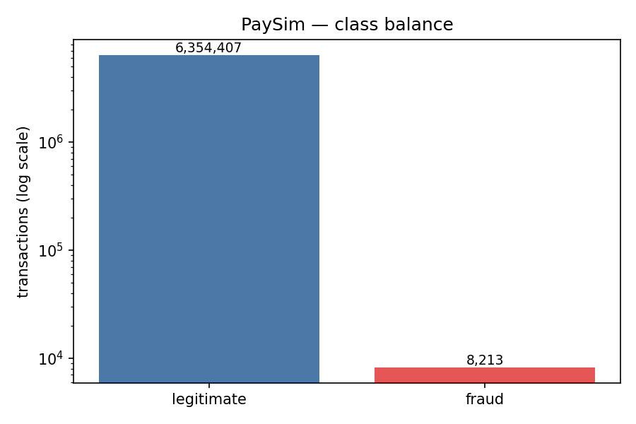
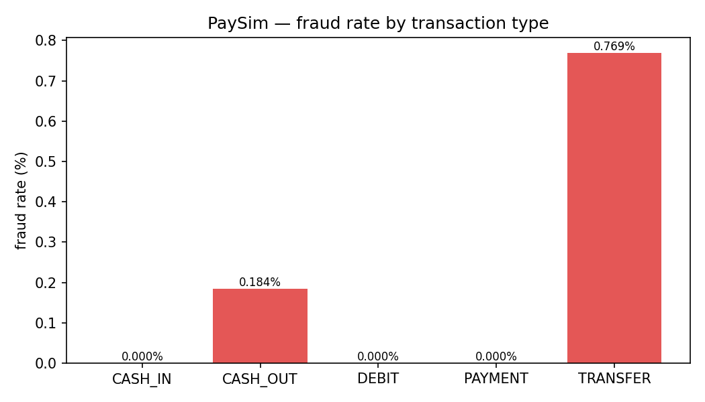
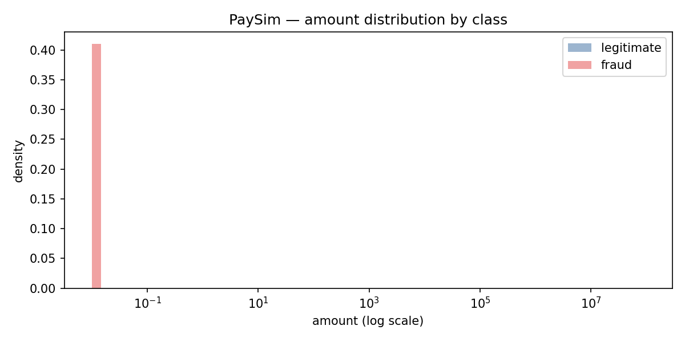
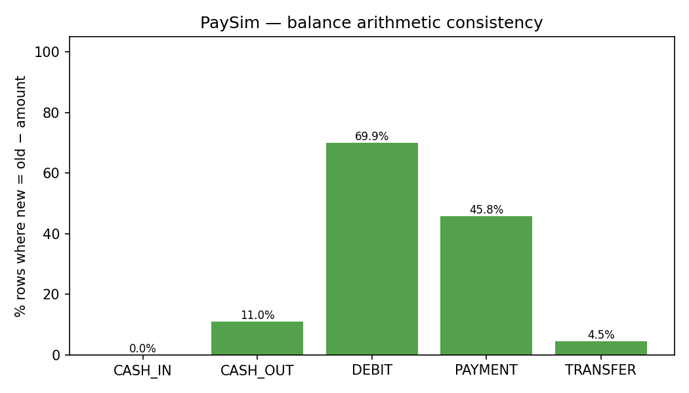
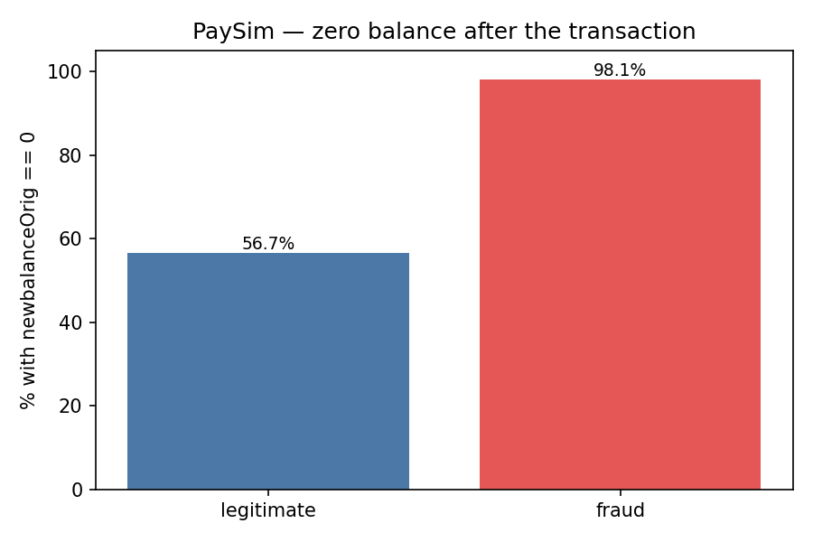

# PaySim — EDA Report (first pass)

**Generated:** 2026-10-21 · **Script:** `ml/training/eda/eda_profile.py`
**Dataset:** `/home/soulaymane/dev/JEE & ML/fintech-mlops-platform/ml/data/paysim/paysim.parquet`

## 1. Shape and quality

| Metric | Value |
|---|---|
| Rows | 6,362,620 |
| Columns | 11 |
| Missing cells | 0 |
| Duplicate rows | 0 |
| In-memory size | 534 MB |

## 2. Target distribution

| class | count | share_pct |
|---|---|---|
| 0 — legitimate | 6,354,407 | 99.8709 |
| 1 — fraud | 8,213 | 0.1291 |

## 3. Fraud by transaction type

| type | count | frauds | rate_pct |
|---|---|---|---|
| CASH_IN | 1,399,284 | 0 | 0.0000 |
| CASH_OUT | 2,237,500 | 4,116 | 0.1840 |
| DEBIT | 41,432 | 0 | 0.0000 |
| PAYMENT | 2,151,495 | 0 | 0.0000 |
| TRANSFER | 532,909 | 4,097 | 0.7688 |

## 4. Amount by class

| isFraud | count | mean | std | min | 25% | 50% | 75% | max |
|---|---|---|---|---|---|---|---|---|
| 0.0000 | 6,354,407.0000 | 178,197.0417 | 596,236.9813 | 0.0100 | 13,368.3950 | 74,684.7200 | 208,364.7600 | 92,445,516.6400 |
| 1.0000 | 8,213.0000 | 1,467,967.2991 | 2,404,252.9472 | 0.0000 | 127,091.3300 | 441,423.4400 | 1,517,771.4800 | 10,000,000.0000 |

## 5. Balance arithmetic consistency

Rows satisfying `newbalanceOrig = oldbalanceOrg − amount` (tolerance 0.01): **20.19%**.

| type | consistent_pct |
|---|---|
| CASH_IN | 0.0000 |
| CASH_OUT | 11.0047 |
| DEBIT | 69.9218 |
| PAYMENT | 45.8101 |
| TRANSFER | 4.5274 |

## 6. The trivial rule

Rows with `amount == oldbalanceOrg` on TRANSFER/CASH_OUT:

- Rows selected: **8,034**
- Fraud among them: **8,034** (100.00%)
- Share of all frauds covered: **97.82%**

This is a property of the simulator. It is why the contract model is expected to score near-perfectly; the restricted ablation (without the new-balance fields) will quantify it.

## 7. `newbalanceOrig == 0`

| isFraud | zero_balance_pct |
|---|---|
| 0.0000 | 56.6774 |
| 1.0000 | 98.0519 |

## 8. Account identity

| Metric | Value |
|---|---|
| Unique `nameOrig` | 6,353,307 |
| Share appearing exactly once | 99.85% |
| Max occurrences of one `nameOrig` | 3 |
| Unique `nameDest` | 2,722,362 |

## 9. `isFlaggedFraud`

- Flagged rows: **16**
- Of those, actual frauds: **16**
- This column is a rule output and is **never** used as a feature.

## 10. Figures

## 11. Findings

1. Fraud is rare (0.129%) and exists only in TRANSFER and CASH_OUT.
2. The label is near-deterministic: `amount == oldbalanceOrg` covers 97.82% of frauds with 100.00% precision.
3. Balance arithmetic is inconsistent on most rows, so balance-based reasoning is artificial.
4. 99.85% of sender accounts appear once — no sender-history features.
5. The contract model will be near-perfect; the restricted ablation and decision-level evaluation are mandatory for a credible report.

## 12. Next steps

- Phase 2: shared preprocessing module, temporal split + calibration split, leakage guards.
- Baseline (Logistic Regression) with the full metric suite.
